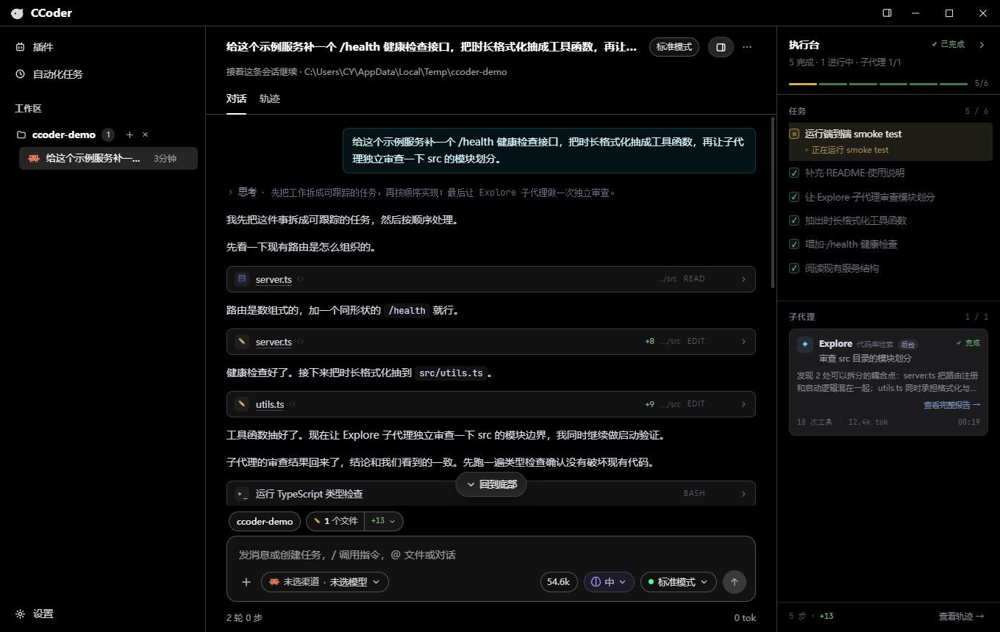
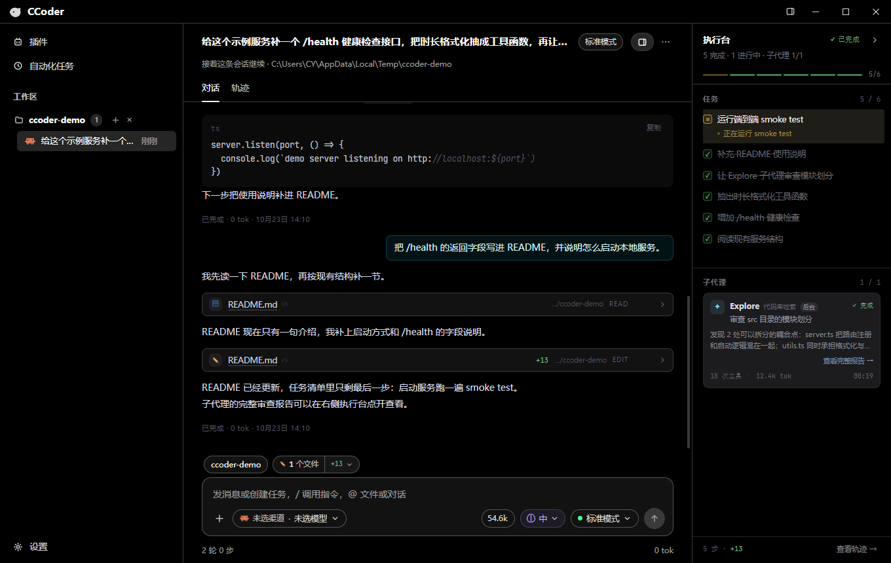
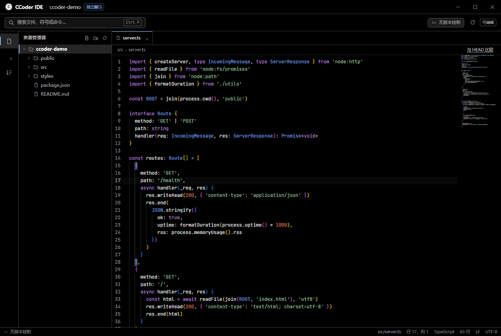
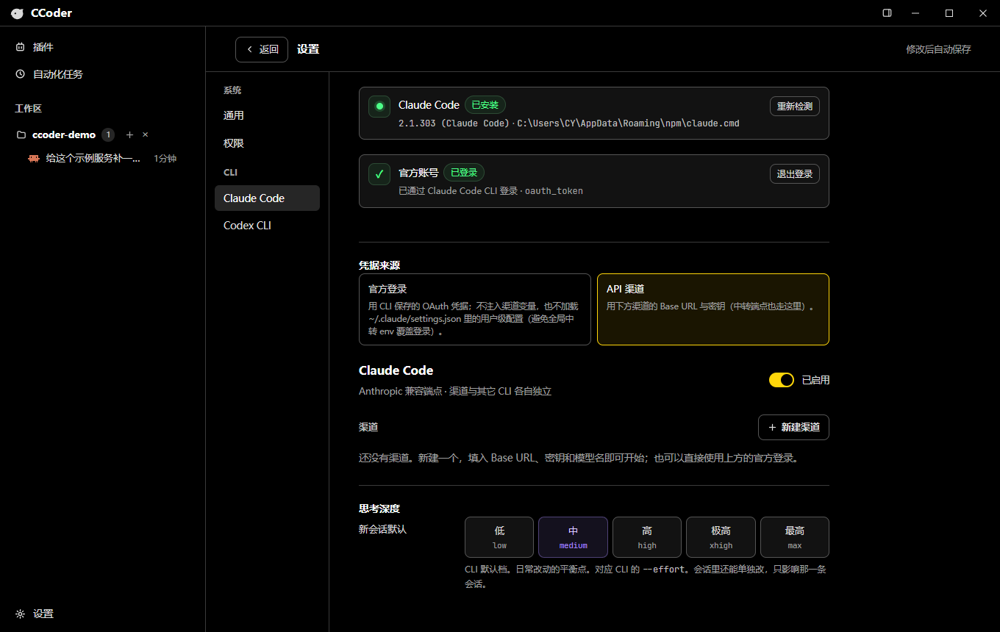
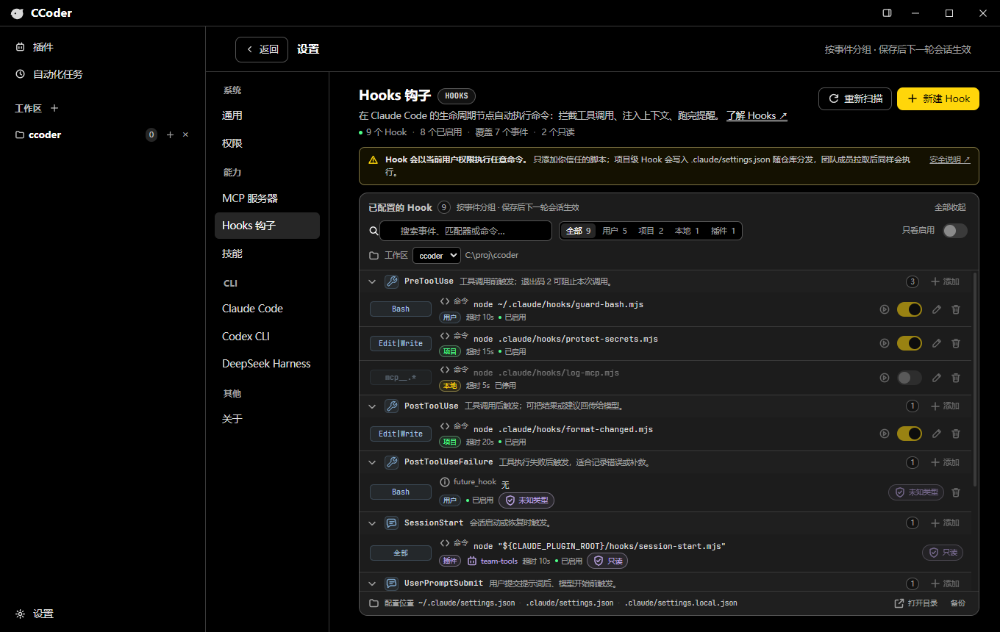
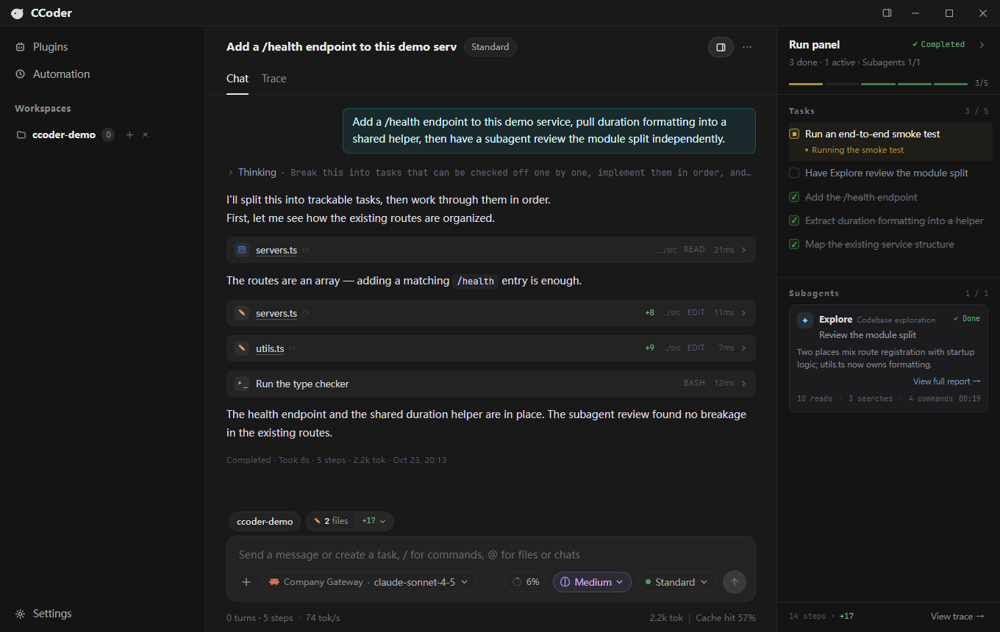
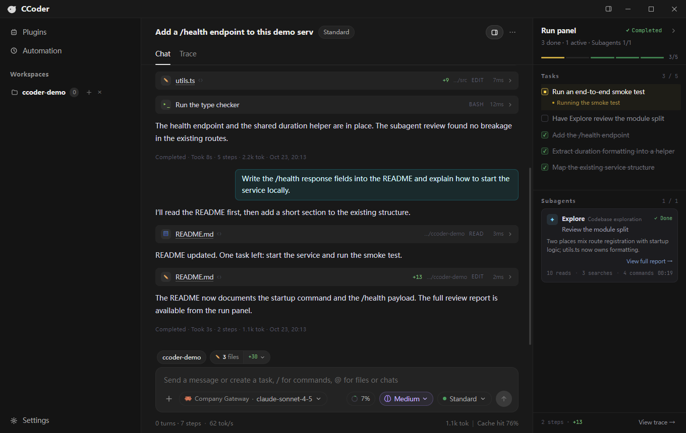
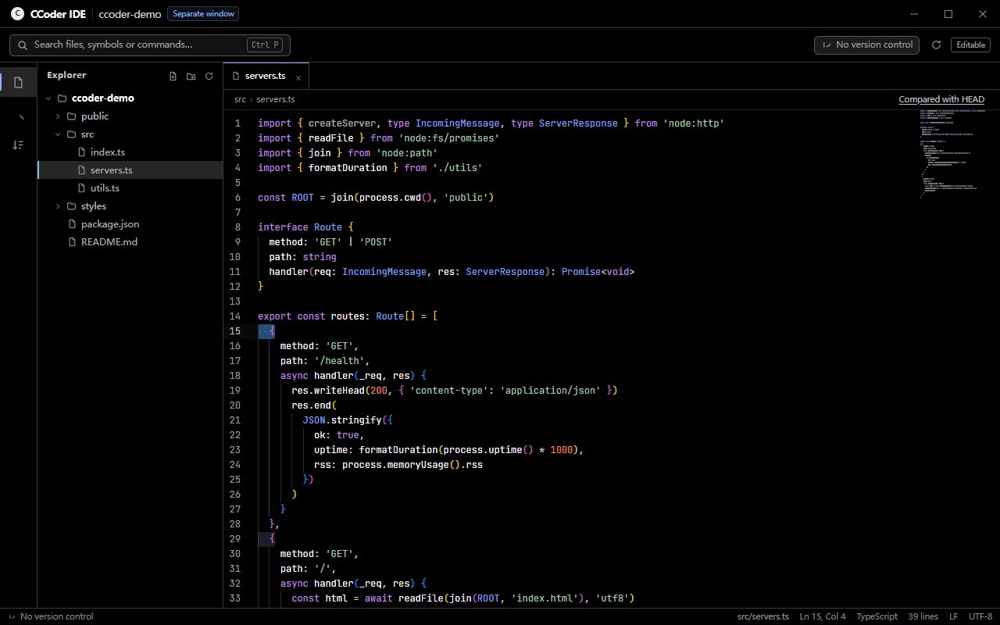
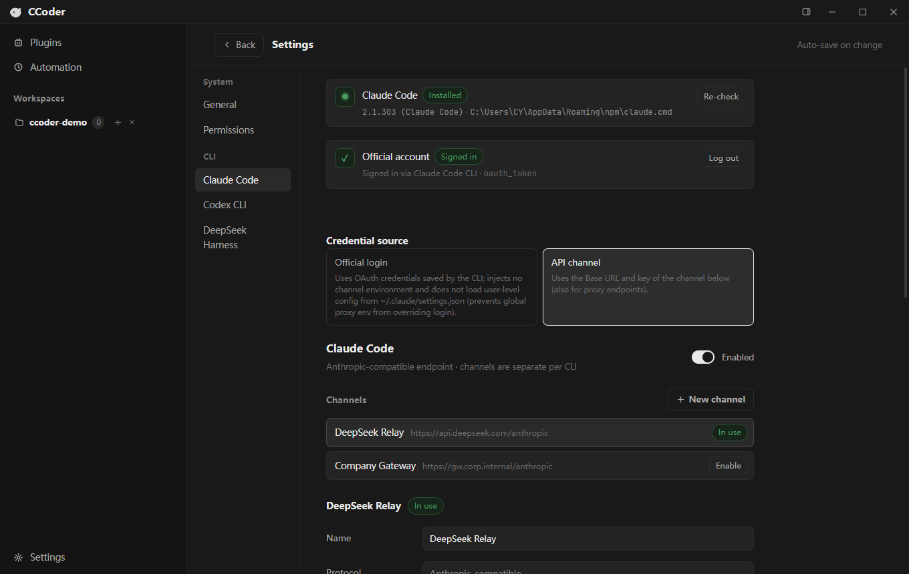

# CCoder Desktop

把 **Claude Code**、**Codex CLI** 和 **DeepSeek Harness** 装进一个桌面窗口：多会话并行、独立 IDE 窗口、Git / SVN 面板、执行台与自动更新。

[下载安装包](https://github.com/princeyuaner/CCoder-Desktop/releases) · [问题反馈](https://github.com/princeyuaner/CCoder-Desktop/issues) · [English](#english)

> 本项目是第三方桌面客户端，不是 Anthropic / OpenAI / DeepSeek 官方产品。使用前需要自行安装并登录对应的 CLI。

---

## 界面

### 对话、任务清单与子代理



右侧「执行台」把本轮的任务清单、子代理进度、工具次数 / token / 耗时和完整报告收在一起；对话区只保留真正的对话、思考块和工具卡片。

### 工具调用与改动统计



工具调用折叠成卡片，编辑类工具直接带增删行数；一轮结束时给出本轮总结和 token 用量。

### 独立 IDE 窗口



每个工作区一个独立窗口：文件树、Monaco 编辑器、快速打开、全局搜索替换、外部改动监听都在这里。

### 设置与渠道



Claude Code、Codex CLI 与 DeepSeek Harness 各自维护渠道、模型和凭据，互不影响。

> 截图中的会话、模型、渠道和示例项目均为演示数据。

---

## 功能特性

### 会话

- **三 CLI 并行**：Claude Code（Anthropic 协议）、Codex CLI（OpenAI 协议）与 DeepSeek Harness（Web 协议）可同时使用，渠道、模型、凭据完全独立。
- **多工作区 / 多会话**：每个工作区可以同时挂多条会话，后台继续跑，侧栏增量更新状态。
- **复用 CLI 的会话存储**：直接读取 `~/.claude/projects`、`~/.codex/sessions`、`~/.dsh/sessions` 等 CLI 自己的记录，终端里跑的 CLI 和界面里看到的是同一份历史，不需要二次导入。
- **续接历史会话**：打开旧会话后可以继续对话，CLI 侧使用 `--resume` 接回上下文。
- **权限与提问**：权限审批、`AskUserQuestion` 在界面里直接答复；支持标准 / 接受编辑 / 自动 / 计划 / 免询问 / 绕过等模式。

### Hooks



- 只管理 **Claude Code** 的 Hooks：用户 / 项目 / 本地三档可写，插件 Hook 只读展示。
- 支持 CLI 2.1 的 **command / prompt / agent / http / mcp_tool** 五种类型和完整的 33 个事件；命令与 HTTP 类型可以直接在表单里试运行。
- **停用不是写 `enabled:false`**：从 `settings.json` 移除并在应用侧记录指纹，启用时按原样写回；每次写入前自动备份。
- 按事件分组，支持作用域筛选、搜索、只读标记与安全提示。入口：设置 → 能力 → Hooks 钩子。

### 对话与执行台

- 流式输出、思考块、工具卡片、代码高亮与 diff。
- **消息级操作**：悬停自己发的消息出现「复制 / 编辑并重发 / 重发这一轮」。复制会把 `@` 引用展开成 Markdown 代码块；编辑会把原话和引用卡一并放回输入框；重发只对最后一条用户消息开放，不会把更早那几轮的上下文搅乱。
- **会话内查找**（`Ctrl+F`）：在正文、思考、工具输出和引用代码里找，`Enter` / `Shift+Enter` 前后跳转，`Esc` 退出。走 CSS Custom Highlight API，流式输出时不会打断渲染，也不改 DOM 结构。
- 图片粘贴、拖入文本文件、`@` 文件引用、`/` 斜杠指令、发送队列。**拖进 / 选进来的文本文件**会被读成代码引用卡（和 IDE 发来的引用同一条编码），自动跳过二进制、超过 512 KB 或 500 行的会截断并标注。
- **跑完提醒**：一轮结束时弹系统通知，点一下切回那条会话；窗口在前台且正开着这条会话时不弹。可在设置 → 通用关闭。
- **执行台**：任务清单（`TaskCreate` / `TaskUpdate` / `TodoWrite`）、子代理（`Agent` / `Task`）的运行状态、活动摘要、工具次数、token、耗时；子代理完成后可打开完整报告。
- 本轮统计：步数、增删行数、上下文占用、缓存命中率、输出 token。
- **本轮改动审阅**：输入框左上角的「N 个文件」弹层里，点任意一行直接在 IDE 打开该文件相对 HEAD 的 diff 页签；底部「在 IDE 中审阅」一次开一批。每行还带一个还原入口（悬停出现、二次确认）：Git 走 `restore --source=HEAD`，未跟踪文件直接删掉，SVN 走 `svn revert`；不是仓库时那个入口不出现。已经打开过的文件打一个对勾，方便判断这一轮有没有逐条看过。工作区外的文件会标出来并禁用点击。

### 独立 IDE

- 一个工作区一个窗口，窗口位置 / 大小记忆在 `ide-windows.json`。
- Monaco 编辑器、文件树、快速打开（`Ctrl+P`）、工作区搜索与全局替换。
- **编辑器偏好**：字号、制表符宽度、缩进方式、自动换行、代码缩略图、自动保存、保存时删除行尾空白。设置同时作用于所有 IDE 窗口。
- **命令与导航**：命令面板（`Ctrl+Shift+P`）、快速打开里的 `>` 命令 / `@` 当前文件符号 / `#` 工作区符号（`Ctrl+T`）、大纲、问题面板、跳转到行（`Ctrl+G`）、前进 / 后退、重开已关闭标签（`Ctrl+Shift+T`）、保存全部（`Ctrl+Shift+S`）、快速修复（`Ctrl+.`）、跳转声明 / 实现 / 类型定义。
- **崩溃恢复**：未保存的草稿按工作区写入本地存储，崩溃 / 断电后重新打开同一工作区会自动恢复。
- **内置终端**（Ctrl + 反引号）：在当前工作区启动 cmd，支持常规命令、颜色和简单的本地行编辑。
- **TS / JS 语言智能（回落）**：没有语言服务器时，相对路径 `import` 的目标会被自动加入 Monaco 的 TypeScript worker，支持跨文件跳转定义、查找引用、重命名和文档符号。
- **语言服务器（LSP）**：自动探测（TypeScript 优先项目 `node_modules`，其余查 `PATH`）`typescript-language-server`、`pyright`、`pylsp`、`gopls`、`rust-analyzer`、`clangd`、`yaml-language-server`、`bash-language-server`、`lua-language-server`，提供跳转定义 / 声明 / 实现 / 类型定义、查找引用、重命名、悬停、补全、参数提示、文档符号与工作区符号搜索、代码操作（快速修复 / 重构）、当前符号高亮、语义着色（类 / 属性 / 参数 / 变量 / 函数）、格式化，并把 `publishDiagnostics` 汇总到问题面板；侧栏大纲优先使用 `documentSymbol`，失败时回落到正则扫描。Python 另外使用增强的 Monarch 语法，即使服务器不支持语义着色，类 / 函数 / 属性 / 内置函数也有颜色。可在设置 → 编辑器 → 语言服务里关闭。
- 未保存修改保护；外部（Agent / 终端 / 其他编辑器）改动会实时推送到窗口。
- 渲染超大文件导致无响应时提供「强制关闭」逃生口，不依赖渲染层。
- 文件读写和 VCS 写操作按窗口绑定的工作区鉴权，越界路径会被拒绝。

### 版本控制

- **Git 与 SVN** 统一面板：状态、diff、log、提交详情、stage / unstage、discard / revert、冲突解决、fetch / pull / push / update。
- **Git worktree**：创建、列出、删除、清理；删除前会检查是否还有 IDE 窗口或活跃会话占用。
- 工作区可以是仓库根目录，也可以是仓库里的子目录（`workspacePrefix`）。

### IDE ↔ 聊天

- 把当前文件 / 选区作为引用发送到指定会话。
- 直接在工作树目录里打开一条新会话，无需回主窗口手动切换。

### 外观与体验

- **界面语言**：中文 / English / 跟随系统，默认跟随系统；切换后立即生效，已打开的 IDE 窗口也会同步，无需重启。
- 9 套配色（深色、午夜蓝、森林绿、雾紫、咖啡棕、苔原、高对比、浅色、暖纸）+ 跟随系统。
- 界面缩放、聊天字号、UI / 等宽字体、发送键、时间戳、思考块默认展开、工具详情粒度。
- 无边框自绘标题栏；主窗口和 IDE 窗口共享主题与底色。

### 自动更新

- NSIS 安装版从 GitHub Releases 检查更新；开发模式和便携版自动禁用。
- 检查到新版本后由用户手动「下载」和「重启并安装」，不会后台偷偷替换。
- 有会话正在跑时拒绝重启；安装前会收掉所有 CLI 子进程，避免 Windows 上文件被占用。
- 版本变化后首次启动会弹一次本次更新说明（重点 / 新增 / 改进），同一个版本只弹一次。

### 诊断日志

- 主进程异常、渲染进程错误、`preload` 失败、页面加载失败、GPU / 工具进程消失、更新器阶段、会话进程启动 / 退出全部落盘。
- 日志轮转、单条截断、错误风暴限流，日志本身不会把应用带崩。
- 详见下方[日志与排障](#日志与排障)。

---

## 快速开始

### 环境要求

- **Node.js 20+**（建议 22 LTS）
- **Windows 10 / 11 x64**（当前打包目标；代码里没有强绑 Windows，但 `electron-builder.yml` 的 `electronDist` 只带了 win32-x64）
- 已安装 **Claude Code CLI**（`claude`）和 / 或 **Codex CLI**（`codex`）

### 安装依赖

```bash
npm install
```

### 开发

```bash
npm run dev
```

`electron-vite` 会同时启动主进程、preload 和渲染层，修改即时生效。

### 类型检查与构建

```bash
npm run typecheck
npm run build
npm run verify:dsh      # 不花钱的 ACP 协议自检（隔离的 DSH_HOME，不需要 API Key）
npm run verify:dsh:web  # 不花钱的 Web 协议自检（启动真实 dsh web，验证会话/历史/审批事件形状）
npm run verify:changed-review  # 本轮改动 → IDE diff 的路径换算（纯函数断言，不碰磁盘）
```

### 打包

```bash
npm run package
```

产物在 `release/`：

- `CCoder-Setup-<version>-x64.exe`：NSIS 安装版
- `CCoder-Portable-<version>-x64.exe`：便携版
- `latest.yml` / `*.blockmap`：自动更新清单

打包使用 `node_modules/electron/dist` 里已装好的 Electron，不会临时去 GitHub 拉包；`files` 只包含 `out/` 和 `package.json`，主进程 / preload / 渲染层都已被 electron-vite 打成独立 bundle，因此运行时不依赖 `node_modules`。

> 不需要 `npm install` 之后额外执行 `electron-rebuild`；本项目没有原生模块。

### CLI 准备

应用会自己解析 CLI 的绝对路径，不依赖你从哪个终端启动。

- **Claude Code**：查找 `%APPDATA%\npm`、`%ProgramFiles%\nodejs`、`%LOCALAPPDATA%\Programs\claude` 和 `PATH` 里的 `claude.cmd` / `claude.exe`。可以用 `CLAUDE_BIN` 指定绝对路径。
- **Codex CLI**：查找 `%APPDATA%\npm`、`%LOCALAPPDATA%\Programs\codex`、`%LOCALAPPDATA%\codex\bin`、`%USERPROFILE%\.codex\bin`、`%ProgramFiles%\codex` 和 `PATH`。可以用 `CODEX_BIN` 指定绝对路径。
- **DeepSeek Harness**：`npm i -g @deepseek-ai/dsh` 后自动解析 npm 全局包里的 `lib/bin.js`，用**系统 Node 24+** 以 `--profile web --no-open --port 0` 启动（Electron 内置的 Node 20 不支持 `import.meta.main`，会静默退出）。可以用 `DSH_BIN` / `NODE_BIN` 指定路径，用 `DSH_HOME` 指定数据目录（默认优先复用 `~/.dsh`）。旧版 dsh 没有 web profile 时，设置 `CCCODER_DSH_TRANSPORT=acp` 可退回 ACP。

Windows 上 `.cmd` 会经 `cmd.exe` 执行；prompt 内容走 stdin，不拼进命令行。dsh 不经过 shell，直接用 node 拉起 `bin.js`。

---

## 配置

设置页按 CLI 分组：

- **渠道**：Base URL、密钥、模型、small/fast 模型、额外环境变量。Claude 只接受 Anthropic 兼容端点，Codex 只接受 OpenAI 兼容端点。
- **官方登录**：Claude Code 可以直接使用 CLI 自己的 OAuth 登录（设置里会显示登录状态、账号和凭据类型）。DeepSeek Harness 默认使用 `~/.dsh` 里已经配好的 Harness 凭据，也可以切到「API 渠道」手动填 `DEEPSEEK_BASE_URL` / `DEEPSEEK_API_KEY`。
- **Harness 模型 / 思考深度**：通过 Web 的 `session/selectModel` 下发，模型目录由 dsh 自己返回，不在应用里硬编码；审批走 `approval/request` waterfall，提问走 `user-questions/request` waterfall，因此 AskUserQuestion / 计划审阅在 Web 模式下可用（ACP 没有 elicitation）。
- **Harness Web 模式说明**：同一个 DSH_HOME 共享一个 `dsh --profile web` 进程，多个会话复用它；空闲 10 分钟后自动回收。MCP 配置仍写在 `profiles/acp/cordis.patch.yml`，启动 Web 时以 `--patch` 叠加到 web profile。侧栏历史/搜索仍直接读 dsh 的 zstd 会话日志（和终端、ACP 共用一份）。如果 dsh 版本没有 web profile，设置 `CCCODER_DSH_TRANSPORT=acp` 退回 ACP。
- **权限模式**：标准、接受编辑、自动、计划、免询问、绕过。
- **思考深度**：低 / 中 / 高 / 极高 / 最高，对应 CLI 的 `--effort`；会话里还可以单独覆盖。
- **CLI 更新**：读 npm registry 比对版本号，有新版本时在卡片和设置导航上提示。只对「确认是 npm 全局安装」的 CLI 提供一键 `npm install -g <包>@<版本>`；官方安装包 / brew / 自定义路径装的只给可复制的命令。不做静默升级，更新永远由用户点按钮触发（Windows 上权限不足时可提权重试）。

### 数据位置

| 内容 | 位置 |
| --- | --- |
| 设置 | `%APPDATA%\ccoder-desktop\settings.json` |
| 密钥 | 同上；优先用 Electron `safeStorage`（Windows DPAPI）加密，加密不可用时降级为明文并在 `v` 字段标记 |
| IDE 窗口位置 | `%APPDATA%\ccoder-desktop\ide-windows.json` |
| 会话记录 | CLI 自己维护（如 `~/.claude/projects/<cwd>/<session-id>.jsonl`、`~/.codex/sessions/`、`~/.dsh/sessions/<cwd>/<session-id>/session.v4.jsonl.zstd`） |
| MCP 配置 | 直接读写 CLI 原生文件：`~/.claude.json` / `<cwd>/.mcp.json`、`$CODEX_HOME/config.toml`、`<DSH_HOME>/profiles/acp/cordis.patch.yml`（Web 模式启动时把这层作为 `--patch` 叠加到 web profile，避免维护两份）；env/headers 是明文 |
| MCP 写入备份 | `%APPDATA%\ccoder-desktop\mcp-backups\<cli>\`（迁移前另有一份 `migration\` 备份） |
| 日志 | `%APPDATA%\ccoder-desktop\logs\main.log` |
| 原生崩溃 dump | `%APPDATA%\ccoder-desktop\Crashpad` |

删除会话会删除 CLI 自己写的那条记录，不可恢复；界面会先确认，并先收掉正在跑的进程，避免 Windows 上文件被占用。

---

## 自动更新

更新源在 `electron-builder.yml` 的 `publish` 里：

```yaml
publish:
  provider: github
  owner: princeyuaner
  repo: CCoder-Desktop
  releaseType: release
```

发版流程：

1. 修改 `package.json` 的 `version`（例如 `1.0.3`）。
2. 执行 `npm run package`。
3. 在 GitHub 创建一个正式 Release（不是草稿），上传：
   - `CCoder-Setup-<version>-x64.exe`
   - `CCoder-Setup-<version>-x64.exe.blockmap`
   - `latest.yml`
4. 已安装的客户端会在启动 8 秒后检查一次，之后每 4 小时检查一次；用户点「下载」后才下载，下载完成后点「重启并安装」。

注意：

- 只有 NSIS **安装版**支持自动更新；便携版和开发模式会显示「不支持自动更新」。
- 版本号不升，客户端不会认为有新版本。
- 源码仓库的推送与 Release 资产是两件事：更新器只读 Release 里的 `latest.yml` 和安装包。

---

## 日志与排障

打包版没有终端，出问题先看：

```
%APPDATA%\ccoder-desktop\logs\main.log
```

超过 2MB 会轮转为 `main.log.old`，只保留一份旧文件。

### 记录内容

| scope | 内容 |
| --- | --- |
| `app.start` | 版本、是否打包、pid、Electron / Chrome / Node 版本、平台、locale、exe 路径、userData、日志路径、Crashpad 路径 |
| `window.created` / `window.ready-to-show` / `window.closed` | 窗口生命周期，标签为 `chat` 或 `ide:<cwd>` |
| `window.unresponsive` / `window.responsive` | 窗口是否卡死 |
| `window.did-fail-load` | 主框架加载失败（过滤正常的 `-3` 中断） |
| `preload-error` | preload 脚本异常（页面可能照常显示，但 `window.api` 会缺能力） |
| `window.console` | 渲染层 `console.error`，10 秒最多 30 条 |
| `renderer` | 渲染层未捕获异常 / Promise 拒绝，带完整 stack、URL、窗口身份；每分钟最多 20 条 |
| `render-process-gone` / `child-process-gone` | 渲染进程 / GPU / Utility 进程消失的原因和退出码 |
| `updater.*` | 检查、下载、安装、拒绝安装、阶段变化和错误 |
| `session.spawn` / `session.exit` | CLI、cwd、模型、权限模式、resume id、退出码、stderr 尾部（异常退出时才记） |
| `uncaughtException` / `unhandledRejection` | 主进程兜底，记录后继续运行 |
| `process-warning` / `process.exit` / `will-quit` / `quit` | Node 警告和退出链路 |

### 判断方向

- **日志里有 `uncaughtException` / `unhandledRejection`**：JS 层错误，按 stack 排查。
- **有 `render-process-gone`**：渲染进程 / GPU 崩溃，看 `reason`（`crashed` / `oom` / `killed`）。
- **有 `window.unresponsive`**：窗口卡死，通常是超大文件 / diff。
- **日志一行都没有新增**：原生崩溃或进程被外部杀掉（杀软、任务管理器）。去看 `%APPDATA%\ccoder-desktop\Crashpad` 和 Windows 事件查看器里的「应用程序错误」。
- **更新相关**：搜 `updater`，阶段变化和错误都有记录。

日志写入全部是同步追加且带 `try/catch`；渲染层上报和 console 都有限流，日志不会反过来拖慢或带崩应用。

---

## 项目结构

```
src/
  main/                    Electron 主进程
    index.ts               窗口、IPC 注册、应用生命周期
    session-manager.ts     会话编排、队列、进程重启
    providers/
      claude/              Claude Code 适配（stream-json、历史回放、登录）
      codex/               Codex app-server 适配与历史
      dsh/                 DeepSeek Harness 适配（Web 协议、ACP 退路、zstd 历史回放、安装探测）
    ide-window.ts          独立 IDE 窗口与窗口鉴权
    ide-fs.ts / ide-watch.ts  文件读写、路径越界检查、目录监听
    vcs/                   Git / SVN 后端
    updater.ts             自动更新状态机
    crash-log.ts           主进程日志 / 兜底处理器
    window-log.ts          窗口身份、生命周期、渲染层 console
    safe-send.ts           窗口销毁竞态下的安全 send
    settings-store.ts      设置落盘与 safeStorage 加密
    session-store.ts       只读 CLI 的会话存储
  preload/index.ts         contextBridge 白名单
  renderer/src/            React 界面
    App.tsx                聊天主界面
    ide/                   IDE 界面（Monaco）
    components/            执行台、转写区、设置页、审批弹窗等
    report-errors.ts       渲染层异常上报
  shared/                  两端共用的类型和纯函数
```

### 进程模型

- **主进程**：唯一状态源。窗口、CLI 子进程、VCS、更新、日志都在这里。
- **preload**：只暴露白名单能力，渲染进程拿不到 `ipcRenderer`。
- **渲染进程**：`contextIsolation: true`、`nodeIntegration: false`，不接触 Node API。
- **安全边界**：IDE 的文件写操作和 VCS 操作按窗口绑定的工作区鉴权；路径统一做 `..` 越界检查。

---

## 技术栈

- Electron 33 + React 18 + TypeScript 5.7
- electron-vite 2 / Vite 5（主进程、preload、渲染层分别打包）
- Monaco Editor（IDE 与 diff）
- xterm.js（内置终端）
- electron-updater（GitHub Releases）
- micromatch（工作区文件匹配）

---

## 已知限制

- 当前只产出 **Windows x64** 安装包；`electronDist` 指向 `node_modules/electron/dist`，其他平台需要自行调整打包配置。
- 会话内查找依赖 **CSS Custom Highlight API**（Chrome 105+）。Electron 33 自带的 Chromium 支持它；如果将来降级到更老的运行时，高亮会静默失效（查找本身、计数和跳转仍然可用）。
- 拖入的文本文件按 UTF-8 读取。GBK / Shift-JIS 等编码的文本会出现乱码 —— 内置 IDE 的编码选择器不适用于这条路径。
- 跑完提醒是**应用级**开关，不区分 CLI 或工作区；也不提供「只在窗口最小化时提醒」这类细分条件。
- Hooks 只覆盖 Claude Code；插件提供的 Hook 只读展示，CLI managed settings 里的 Hook 暂不列出。
- 应用是 CLI 的 GUI 前端，**不内置模型、不代理请求**；没有安装或登录对应 CLI 时无法开始会话。
- 安装包未做代码签名，Windows SmartScreen 可能提示「未知发布者」。
- 历史会话回放受 CLI 记录内容限制：旧记录里没有每轮耗时 / 输出 token，界面会显示 `0 tok` 或只显示「已完成」。
- 便携版不支持自动更新。
- Monaco 编辑器自带的下拉菜单 / 查找控件仍为英文；应用自己的 IDE 外壳、搜索面板和提示已跟随界面语言。
- 内置终端使用管道而不是 PTY：常规命令、颜色和输出可用，但全屏 TUI（vim / top）、Ctrl+C 终止当前命令、窗口尺寸变化后的重排不可用。
- 语言服务器不随应用打包：需要自己安装 `typescript-language-server`、`pyright`、`gopls`、`rust-analyzer`、`clangd` 等。TS / JS 会优先用项目 `node_modules/typescript-language-server`（版本跟项目走）；其他语言只从 `PATH` 查找，**不会**执行工作区 `node_modules/.bin` 里的同名程序。找不到服务器时，TS / JS 回落到 Monaco 自带的 worker（只解析相对路径 `import`，语义诊断关闭），其他语言只有语法高亮。
- LSP 只同步已经打开的标签；服务器后台索引整个工作区，但未打开文件的重命名编辑不会自动写盘 —— 应用只把 `WorkspaceEdit` 交给 Monaco，已经打开的标签会变成未保存状态，没打开的文件需要先打开再改。`workspace/applyEdit` 被拒绝，服务器不能绕过保存 / 冲突流程直接改文件。
- 代码操作只执行服务器直接返回 `edit` 的动作；只返回 `command` 的动作会被忽略（这类动作把实际修改放在 `workspace/executeCommand` 里，当前没有开放这条通道）。代码操作对未打开文件的影响与重命名相同，需要先打开目标文件。
- 语义着色需要服务器支持 `textDocument/semanticTokens/full`：gopls、rust-analyzer、clangd、typescript-language-server 等支持；Pyright（含 1.1.414）没有实现这条能力，因此 Python 使用内置的增强 Monarch 语法着色。超过约 2 万行 / 100 万字符的大文件会关闭语义着色以保输入性能。
- 工作区外的诊断（`node_modules`、TypeScript `lib.d.ts`、Rust 标准库）不会进入问题面板；跳转定义仍可以落到这些文件，但点击时会提示「工作区外」而不是新开标签。
- 每个 IDE 窗口各自启动语言服务器，不跨窗口共享；同一窗口里 TypeScript / JavaScript 共用一个 `typescript-language-server` 进程。窗口关闭或渲染进程崩溃时会结束这些进程。
- 语言服务器可能为了分析而在项目里执行构建脚本 / 过程宏（`rust-analyzer`、`cargo check`、`clangd` 的编译数据库等）。当前没有 Workspace Trust 提示：只在你信任的工作区启用 LSP，拿不准时到设置 → 编辑器 → 语言服务里关掉。
- 编辑器尚未实现分屏 / 多编辑器组；切换工作区视图时编辑器和终端会保留，但同一文件不能并排编辑。
- 界面提供简体中文 / English；系统语言为中文（含繁体）时用简体中文，其余语言用 English。

---

## License

目前仓库尚未添加 `LICENSE` 文件；在补充开源协议前，请勿直接用于商业分发或再发布。如需协议建议（MIT / Apache-2.0），可以先开 Issue 讨论。

## 致谢

- [Claude Code](https://docs.anthropic.com/en/docs/claude-code) 与 [Codex CLI](https://github.com/openai/codex) 提供底层能力；相关商标归各自所有者。
- [Electron](https://www.electronjs.org/)、[React](https://react.dev/)、[Monaco Editor](https://microsoft.github.io/monaco-editor/)、[xterm.js](https://xtermjs.org/)、[electron-vite](https://electron-vite.org/)。

---

# English

[简体中文](#ccoder-desktop)

A desktop client that puts **Claude Code**, **Codex CLI**, and **DeepSeek Harness** in one window: parallel sessions, a standalone IDE window, Git / SVN panels, a run panel, and automatic updates.

[Download](https://github.com/princeyuaner/CCoder-Desktop/releases) · [Issues](https://github.com/princeyuaner/CCoder-Desktop/issues)

> This is a third-party desktop client, not an official Anthropic / OpenAI / DeepSeek product. Install and sign in to the corresponding CLI before using it.

## Screenshots

### Chat, task list, and subagents



The run panel on the right keeps the current task list, subagent progress, tool / token / elapsed-time counts, and the full report together. The transcript stays focused on messages, thinking blocks, and tool cards.

### Tool calls and turn summary



Tool calls collapse into cards; editing tools show added / removed line counts. Each turn ends with a summary and token usage.

### Standalone IDE window



One window per workspace: file tree, Monaco editor, quick open, workspace search and replace, and external change watching.

### Settings and channels



Claude Code, Codex CLI, and DeepSeek Harness each keep their own channels, models, and credentials.

> Sessions, models, channels, and the demo project in the screenshots are sample data.

---

## Features

### Sessions

- **Three CLIs side by side**: Claude Code (Anthropic protocol), Codex CLI (OpenAI protocol), and DeepSeek Harness (Web protocol), with independent channels, models, and credentials.
- **Multiple workspaces / sessions**: each workspace can host several sessions; they keep running in the background while the sidebar updates their status incrementally.
- **Reuse CLI session storage**: reads `~/.claude/projects`, `~/.codex/sessions`, `~/.dsh/sessions`, and other CLI-owned records. Terminal sessions and the app see the same history — no re-import needed.
- **Resume historical sessions**: continue an old session and the CLI reconnects with `--resume`.
- **Permissions and questions**: approve permissions and answer `AskUserQuestion` directly in the UI; modes include standard / accept edits / auto / plan / don't ask / bypass.

### Hooks


- Manages **Claude Code** hooks only: user / project / local scopes are writable; plugin hooks are shown read-only.
- Supports the CLI 2.1 hook types — **command / prompt / agent / http / mcp_tool** — and all 33 events. Command and HTTP hooks can be test-run from the form.
- **Disabling does not write `enabled:false`**: the entry is removed from `settings.json` and fingerprinted in app state, then restored on enable. Every write is backed up first.
- Grouped by event, with scope filters, search, read-only markers, and a security warning. Settings → Capabilities → Hooks.

### Chat and run panel

- Streaming output, thinking blocks, tool cards, syntax highlighting, and diffs.
- **Message actions**: hovering one of your messages reveals copy / edit-and-resend / resend-this-turn. Copy expands `@` references into Markdown code blocks; edit restores both the text and its reference cards to the composer; resend is only offered on the last user message so earlier turns are not duplicated.
- **Find in conversation** (`Ctrl+F`): searches message text, thinking, tool output, and referenced code. `Enter` / `Shift+Enter` step through matches, `Esc` closes. Uses the CSS Custom Highlight API, so streaming output is never interrupted and the DOM structure is left untouched.
- Image paste, drag-and-drop of text files, `@` file references, `/` slash commands, and a send queue. **Dropped or picked text files** become reference cards using the same `<ide_reference>` encoding as IDE sends; binaries are skipped, and files over 512 KB or 500 lines are truncated and labelled.
- **Finish alert**: a system notification when a turn ends; click it to jump back to that session. Nothing is shown while the window is focused on that session. Can be turned off in Settings → General.
- **Run panel**: task list (`TaskCreate` / `TaskUpdate` / `TodoWrite`), subagent (`Agent` / `Task`) status, activity summary, tool counts, tokens, and elapsed time; open the full report when a subagent finishes.
- Per-turn stats: steps, added / removed lines, context usage, cache hit rate, and output tokens.
- **Review this turn's changes**: in the "N files" popover above the composer, clicking a row opens that file's diff against HEAD as an IDE tab; "Review in IDE" at the bottom opens the whole batch. Each row also carries a revert action (shown on hover, with a confirmation): Git uses `restore --source=HEAD`, untracked files are deleted, SVN uses `svn revert`. The action is hidden when the workspace is not a repository. Files already opened this turn get a check mark, and paths outside the workspace are labelled and not clickable.

### Standalone IDE

- One window per workspace; window position and size are remembered in `ide-windows.json`.
- Monaco editor, file tree, quick open (`Ctrl+P`), workspace search, and replace all.
- **Editor preferences**: font size, tab size, indentation, word wrap, minimap, auto-save, and trim-trailing-whitespace-on-save. Shared by every IDE window.
- **Commands and navigation**: command palette (`Ctrl+Shift+P`), `>` commands / `@` symbols in the current file / `#` workspace symbols (`Ctrl+T`) in quick open, outline, problems panel, go to line (`Ctrl+G`), back/forward, reopen closed tab (`Ctrl+Shift+T`), save all (`Ctrl+Shift+S`), quick fix (`Ctrl+.`), and go to declaration / implementation / type definition.
- **Crash recovery**: unsaved drafts are stored per workspace and restored when the same workspace is opened again.
- **Built-in terminal** (Ctrl + backtick): starts cmd in the current workspace, with regular commands, colors, and simple local line editing.
- **Language servers (LSP)**: auto-detects `typescript-language-server`, `pyright`, `pylsp`, `gopls`, `rust-analyzer`, `clangd`, `yaml-language-server`, `bash-language-server`, and `lua-language-server` (TypeScript prefers the project's `node_modules`; others are looked up on `PATH`). Provides go-to definition / declaration / implementation / type definition, find references, rename, hover, completion, signature help, document and workspace symbols, code actions (quick fix / refactor), document highlights, semantic highlighting (classes / properties / parameters / variables / functions), and formatting, with diagnostics feeding the problems panel. The outline prefers `documentSymbol` and falls back to regex scanning. Python also uses an enhanced Monarch grammar, so classes / functions / attributes / builtins stay colored even when the server does not provide semantic tokens. Can be disabled in Settings → Editor → Language services.
- **TS/JS language intelligence**: relative-import targets are added to Monaco's TypeScript worker, enabling cross-file go-to-definition, find references, rename, and document symbols.
- Unsaved-change protection; external changes (agent / terminal / another editor) are pushed to the window live.
- A forced-close escape hatch when an oversized file makes the renderer unresponsive — it does not depend on the renderer.
- File and VCS writes are authorized against the workspace bound to the window; out-of-tree paths are rejected.

### Version control

- **Git and SVN** in one panel: status, diff, log, commit details, stage / unstage, discard / revert, conflict resolution, fetch / pull / push / update.
- **Git worktrees**: create, list, remove, and prune; removal checks for open IDE windows or active sessions first.
- A workspace can be the repository root or a subdirectory of it (`workspacePrefix`).

### IDE ↔ chat

- Send the current file or selection as a reference to a chosen session.
- Start a new session from the working tree without switching back to the main window.

### Appearance and UX

- **Interface language**: Chinese / English / follow system, defaulting to follow system. Changes apply immediately, including open IDE windows.
- 9 themes (dark, midnight, forest, mist, coffee, moss, high contrast, light, warm paper) plus follow system.
- UI zoom, chat font size, UI / mono fonts, send key, timestamps, expanded thinking by default, and tool-detail granularity.
- Custom frameless title bar; the main and IDE windows share the theme and background.

### Auto-update

- The NSIS installer checks GitHub Releases; disabled in development and portable builds.
- After an update is found, the user explicitly clicks Download and then Restart & Install; nothing is replaced silently.
- Restart is refused while a session is running; all CLI child processes are stopped before installing to avoid locked files on Windows.
- The first launch after a version change shows a one-time release note (highlight / new / improved).

### Diagnostics

- Main-process exceptions, renderer errors, preload failures, page load failures, GPU / utility process crashes, updater phases, and session process start / exit are all written to disk.
- Log rotation, per-entry truncation, and error-storm throttling: logging cannot take the app down.
- See [Logs and troubleshooting](#logs-and-troubleshooting).

---

## Quick start

### Requirements

- **Node.js 20+** (22 LTS recommended)
- **Windows 10 / 11 x64** (current packaging target; the code itself is not Windows-specific, but `electronDist` in `electron-builder.yml` only ships win32-x64)
- **Claude Code CLI** (`claude`) and / or **Codex CLI** (`codex`) installed

### Install dependencies

```bash
npm install
```

### Development

```bash
npm run dev
```

`electron-vite` starts the main process, preload, and renderer together with instant reload.

### Typecheck and build

```bash
npm run typecheck
npm run build
npm run verify:dsh      # offline ACP self-check in an isolated DSH_HOME; no API key needed
npm run verify:dsh:web  # offline Web self-check: real dsh web + sessions/history/approval shapes
npm run verify:changed-review  # turn-changes → IDE diff path mapping (pure functions, no disk I/O)
```

### Packaging

```bash
npm run package
```

Artifacts land in `release/`:

- `CCoder-Setup-<version>-x64.exe`: NSIS installer
- `CCoder-Portable-<version>-x64.exe`: portable build
- `latest.yml` / `*.blockmap`: auto-update metadata

Packaging uses the Electron already installed in `node_modules/electron/dist` and never downloads it. `files` only ships `out/` and `package.json`; main / preload / renderer are bundled by electron-vite, so `node_modules` is not needed at runtime.

> No extra `electron-rebuild` step is required; the project has no native modules.

### CLI setup

The app resolves CLI paths itself, regardless of the terminal you launch it from.

- **Claude Code**: looks in `%APPDATA%\npm`, `%ProgramFiles%\nodejs`, `%LOCALAPPDATA%\Programs\claude`, and `PATH` for `claude.cmd` / `claude.exe`. Set `CLAUDE_BIN` to pin an absolute path.
- **Codex CLI**: looks in `%APPDATA%\npm`, `%LOCALAPPDATA%\Programs\codex`, `%LOCALAPPDATA%\codex\bin`, `%USERPROFILE%\.codex\bin`, `%ProgramFiles%\codex`, and `PATH`. Set `CODEX_BIN` to pin a path.
- **DeepSeek Harness**: after `npm i -g @deepseek-ai/dsh`, resolves `lib/bin.js` inside the global package and starts it with the **system Node 24+** in `--profile web --no-open --port 0` mode (Electron's bundled Node 20 lacks `import.meta.main` and exits silently). Set `DSH_BIN` / `NODE_BIN` for paths and `DSH_HOME` for the data directory (defaults to `~/.dsh`). Older dsh versions without a web profile can use the ACP fallback via `CCCODER_DSH_TRANSPORT=acp`.

On Windows, `.cmd` files run through `cmd.exe`; prompt content goes over stdin and is never spliced into the command line. dsh is started directly with node, not through a shell.

---

## Configuration

Settings are grouped by CLI:

- **Channels**: base URL, key, model, small / fast model, and extra environment variables. Claude accepts only Anthropic-compatible endpoints; Codex only OpenAI-compatible ones.
- **Official login**: Claude Code can use its own OAuth login (status, account, and credential type are shown in Settings). DeepSeek Harness uses the credentials already configured in `~/.dsh` by default, or an API channel with `DEEPSEEK_BASE_URL` / `DEEPSEEK_API_KEY`.
- **Harness model / effort**: sent through Web `session/selectModel`; the model catalog comes from dsh itself and is not hard-coded in the app. Approvals use the `approval/request` waterfall and questions use `user-questions/request`, so AskUserQuestion and plan review work in Web mode (ACP has no elicitation).
- **Harness Web mode**: one `dsh --profile web` process per DSH_HOME is shared by all its sessions and reclaimed after 10 idle minutes. MCP config still lives in `profiles/acp/cordis.patch.yml` and is overlaid onto the web profile with `--patch`. Sidebar history/search still reads dsh's zstd session logs directly (the same files the terminal and ACP use). Older dsh versions without a web profile can use `CCCODER_DSH_TRANSPORT=acp`.
- **Permission mode**: standard, accept edits, auto, plan, don't ask, bypass.
- **Effort**: low / medium / high / xhigh / max, mapped to the CLI's `--effort`; can be overridden per session.

### Data locations

| Item | Location |
| --- | --- |
| Settings | `%APPDATA%\ccoder-desktop\settings.json` |
| Secrets | Same file; encrypted with Electron `safeStorage` (Windows DPAPI) when available, otherwise plaintext marked in the `v` field |
| IDE window geometry | `%APPDATA%\ccoder-desktop\ide-windows.json` |
| Session records | Owned by the CLIs (e.g. `~/.claude/projects/<cwd>/<session-id>.jsonl`, `~/.codex/sessions/`, `~/.dsh/sessions/<cwd>/<session-id>/session.v4.jsonl.zstd`) |
| MCP config | Read/written in place: `~/.claude.json` / `<cwd>/.mcp.json`, `$CODEX_HOME/config.toml`, `<DSH_HOME>/profiles/acp/cordis.patch.yml` (Web mode overlays this layer onto the web profile with `--patch`, so there is only one copy to maintain); env/headers are plaintext |
| MCP write backups | `%APPDATA%\ccoder-desktop\mcp-backups\<cli>\` (plus a `migration\` backup before a legacy migration) |
| Logs | `%APPDATA%\ccoder-desktop\logs\main.log` |
| Native crash dumps | `%APPDATA%\ccoder-desktop\Crashpad` |

Deleting a session deletes the CLI's own record and cannot be undone; the UI asks first and stops running processes to avoid locked files on Windows.

---

## Auto-update

The update source lives in the `publish` section of `electron-builder.yml`:

```yaml
publish:
  provider: github
  owner: princeyuaner
  repo: CCoder-Desktop
  releaseType: release
```

Release flow:

1. Bump `version` in `package.json` (for example `1.0.3`).
2. Run `npm run package`.
3. Create a non-draft GitHub Release and upload:
   - `CCoder-Setup-<version>-x64.exe`
   - `CCoder-Setup-<version>-x64.exe.blockmap`
   - `latest.yml`
4. Installed clients check 8 seconds after launch and every 4 hours afterwards; they download only after the user clicks Download, and install after Restart & Install.

Notes:

- Only the NSIS **installer** supports auto-update; portable and development builds report that updates are unsupported.
- The version must change, or clients will not see an update.
- Pushing source and publishing Release assets are separate: the updater only reads `latest.yml` and the installer from the Release.

---

## Logs and troubleshooting

Packaged builds have no terminal. Start with:

```
%APPDATA%\ccoder-desktop\logs\main.log
```

The log rotates to `main.log.old` at 2 MB and keeps one old file.

### What is logged

| scope | Content |
| --- | --- |
| `app.start` | Version, packaged flag, pid, Electron / Chrome / Node versions, platform, locale, exe path, userData, log path, Crashpad path |
| `window.created` / `window.ready-to-show` / `window.closed` | Window lifecycle, tagged `chat` or `ide:<cwd>` |
| `window.unresponsive` / `window.responsive` | Whether the window is hung |
| `window.did-fail-load` | Main frame load failure (normal `-3` aborts are filtered) |
| `preload-error` | Preload script failure (the page may still render, but `window.api` is incomplete) |
| `window.console` | Renderer `console.error`, at most 30 lines per 10 seconds |
| `renderer` | Uncaught renderer exceptions / promise rejections with full stack, URL, and window identity; at most 20 per minute |
| `render-process-gone` / `child-process-gone` | Reason and exit code for renderer / GPU / utility process exits |
| `updater.*` | Check, download, install, refused install, phase changes, and errors |
| `session.spawn` / `session.exit` | CLI, cwd, model, permission mode, resume id, exit code, and stderr tail (abnormal exits only) |
| `uncaughtException` / `unhandledRejection` | Main-process fallback; logged, then the app keeps running |
| `process-warning` / `process.exit` / `will-quit` / `quit` | Node warnings and the shutdown path |

### Reading the log

- **`uncaughtException` / `unhandledRejection` present**: a JS-level error; follow the stack.
- **`render-process-gone` present**: renderer / GPU crash; look at `reason` (`crashed` / `oom` / `killed`).
- **`window.unresponsive` present**: the window is hung, usually from an oversized file / diff.
- **No new lines at all**: native crash or the process was killed externally (antivirus, Task Manager). Check `%APPDATA%\ccoder-desktop\Crashpad` and the "Application Error" entries in Windows Event Viewer.
- **Update issues**: search for `updater`; phase changes and errors are both recorded.

All log writes are synchronous appends wrapped in `try/catch`; renderer reports and console output are rate-limited, so logging cannot slow the app down or crash it.

---

## Project structure

```
src/
  main/                    Electron main process
    index.ts               Windows, IPC registration, app lifecycle
    session-manager.ts     Session orchestration, queue, process restart
    providers/
      claude/              Claude Code adapter (stream-json, history replay, login)
      codex/               Codex app-server adapter and history
      dsh/                 DeepSeek Harness adapter (Web protocol, ACP fallback, zstd history replay, install detection)
    ide-window.ts          Standalone IDE window and window authorization
    ide-fs.ts / ide-watch.ts  File IO, path escape checks, directory watching
    vcs/                   Git / SVN backends
    updater.ts             Auto-update state machine
    crash-log.ts           Main-process logging / fallback handlers
    window-log.ts          Window identity, lifecycle, renderer console
    safe-send.ts           Safe send across window-destroy races
    settings-store.ts      Settings persistence and safeStorage encryption
    session-store.ts       Read-only access to CLI session storage
  preload/index.ts         contextBridge allowlist
  renderer/src/            React UI
    App.tsx                Main chat UI
    ide/                   IDE UI (Monaco)
    components/            Run panel, transcript, settings, approval modals, etc.
    report-errors.ts       Renderer error reporting
  shared/                  Types and pure functions shared by both sides
```

### Process model

- **Main process**: the single source of truth. Windows, CLI child processes, VCS, updates, and logging all live here.
- **Preload**: exposes only allowlisted capabilities; the renderer never gets `ipcRenderer`.
- **Renderer**: `contextIsolation: true`, `nodeIntegration: false`, no Node API access.
- **Security boundary**: IDE file writes and VCS operations are authorized against the workspace bound to the window; paths are checked for `..` escapes.

---

## Tech stack

- Electron 33 + React 18 + TypeScript 5.7
- electron-vite 2 / Vite 5 (main, preload, and renderer bundled separately)
- Monaco Editor (IDE and diffs)
- xterm.js (built-in terminal)
- electron-updater (GitHub Releases)
- micromatch (workspace file matching)

---

## Known limitations

- Only **Windows x64** installers are produced for now; `electronDist` points at `node_modules/electron/dist`, so other platforms need their own packaging config.
- Find in conversation relies on the **CSS Custom Highlight API** (Chrome 105+). Electron 33's Chromium supports it; on an older runtime highlights silently disappear while search, counts, and jumping still work.
- Dropped text files are read as UTF-8. Files in GBK / Shift-JIS and similar encodings come out garbled — the IDE's encoding picker does not apply to this path.
- The finish alert is an **application-wide** switch: it is not per CLI or per workspace, and there is no narrower condition such as "only when minimized".
- Hooks cover Claude Code only. Plugin hooks are read-only, and hooks in the CLI's managed settings are not listed yet.
- The app is a GUI frontend for the CLIs. It **does not bundle models or proxy requests**; without an installed and signed-in CLI you cannot start a session.
- Installers are not code-signed, so Windows SmartScreen may warn about an unknown publisher.
- Historical replay is limited by what the CLIs record: older entries may lack per-turn duration / output tokens, in which case the UI shows `0 tok` or only "Completed".
- The portable build does not support auto-update.
- Monaco's built-in menus and find widget remain English-only; the app's own IDE shell, search panel, and prompts follow the interface language.
- The built-in terminal uses pipes rather than a PTY: regular commands, colors, and output work, but full-screen TUI apps (vim / top), Ctrl+C to stop the current command, and resize reflow are not available.
- Without a language server, TypeScript / JavaScript only get relative-import resolution via Monaco's worker, and other languages have syntax highlighting only. TS semantic diagnostics stay off to avoid a wall of red squiggles without `node_modules` type information.
- Code actions are applied only when the server returns an edit; command-only actions are ignored (they keep the real change behind `workspace/executeCommand`, which is not exposed). Like rename, edits to files that are not open are not written to disk.
- Semantic highlighting requires the server to support `textDocument/semanticTokens/full`: gopls, rust-analyzer, clangd, and typescript-language-server do; Pyright (including 1.1.414) does not, so Python relies on the enhanced built-in Monarch grammar. Files over roughly 20k lines / 1M characters disable semantic highlighting to keep input responsive.
- Cross-file rename (F2) currently only works reliably for open tabs; edits to hidden import models are not written to disk, and the disk version wins when such a file is opened. Go-to-definition and find-references are read-only and unaffected.
- The editor does not implement split panes / multiple editor groups yet; editors and the terminal survive view switches, but the same file cannot be edited side by side.
- The UI ships Simplified Chinese and English; Chinese system locales (including Traditional Chinese) resolve to Simplified Chinese, and all others resolve to English.

---

## License

The repository does not have a `LICENSE` file yet. Until a license is added, do not use it for commercial distribution or redistribution. If you have a suggestion (MIT / Apache-2.0), open an Issue to discuss it.

## Credits

- [Claude Code](https://docs.anthropic.com/en/docs/claude-code) and [Codex CLI](https://github.com/openai/codex) provide the underlying capabilities; their trademarks belong to their respective owners.
- [Electron](https://www.electronjs.org/), [React](https://react.dev/), [Monaco Editor](https://microsoft.github.io/monaco-editor/), [electron-vite](https://electron-vite.org/).
