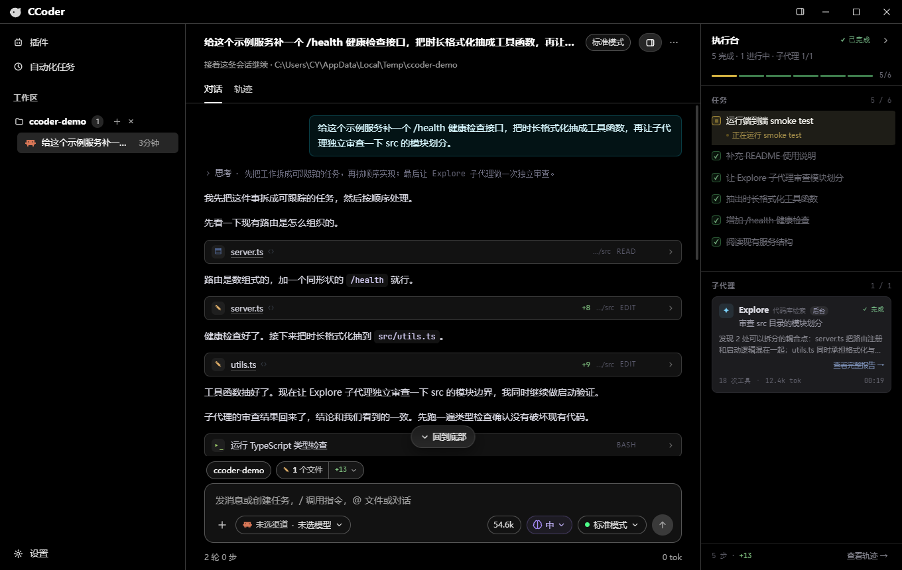
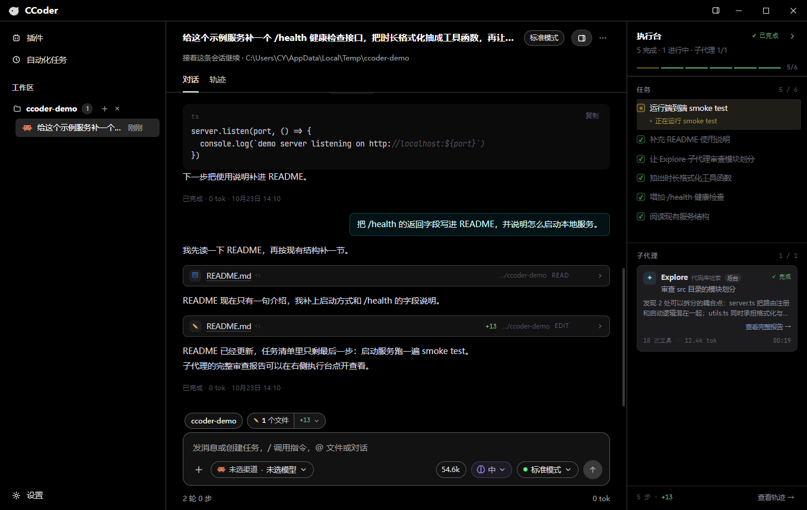
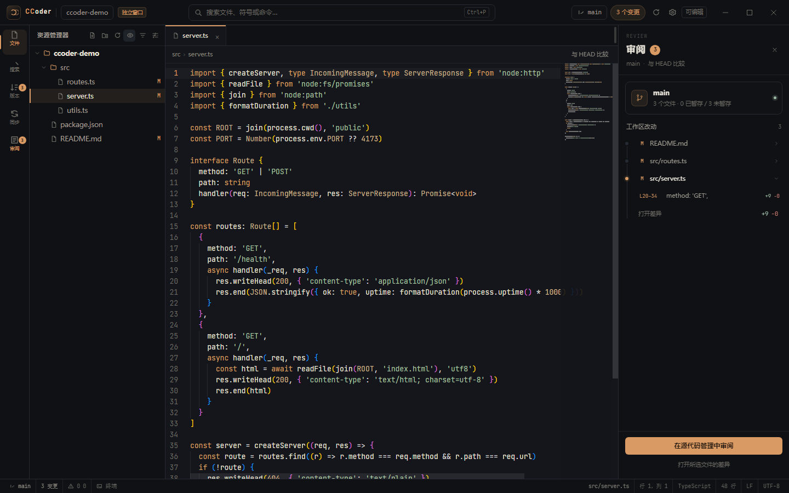
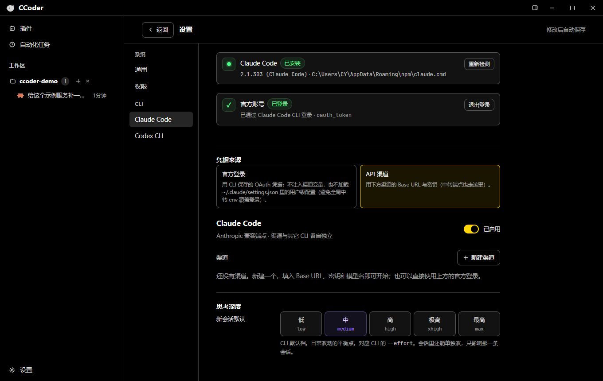
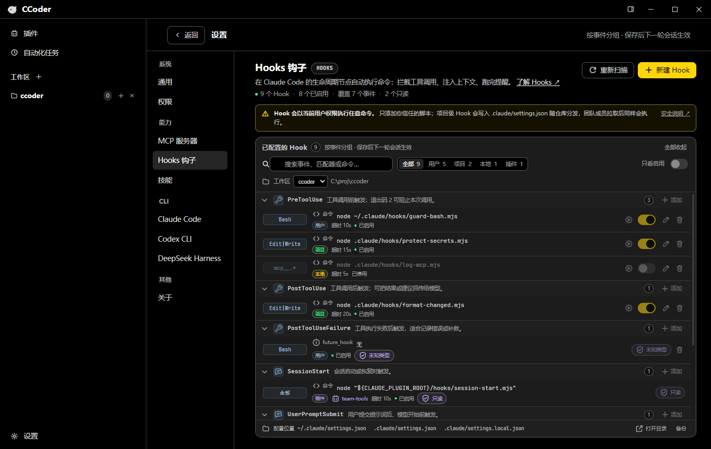
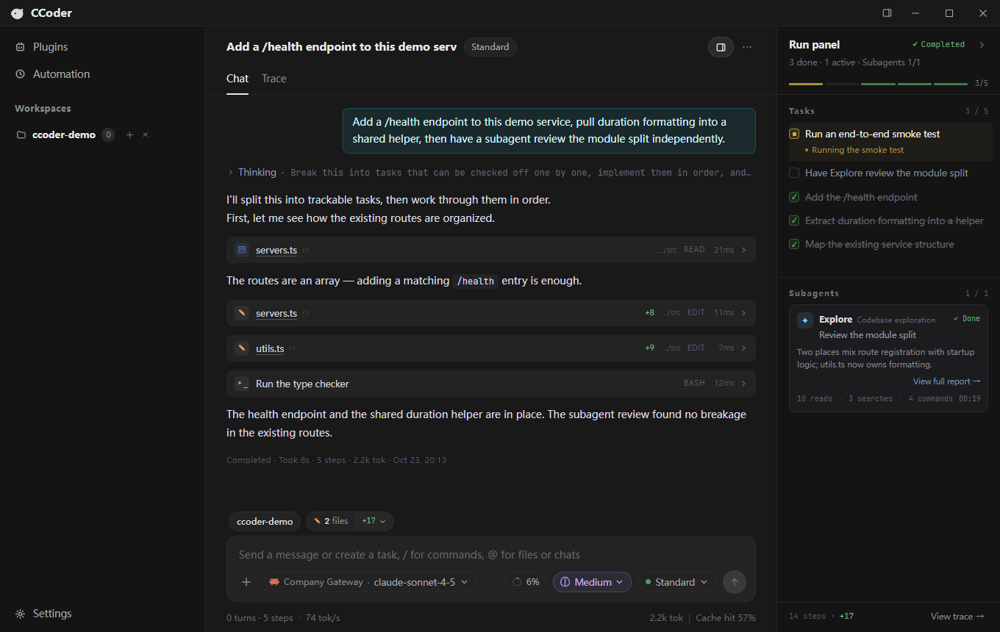
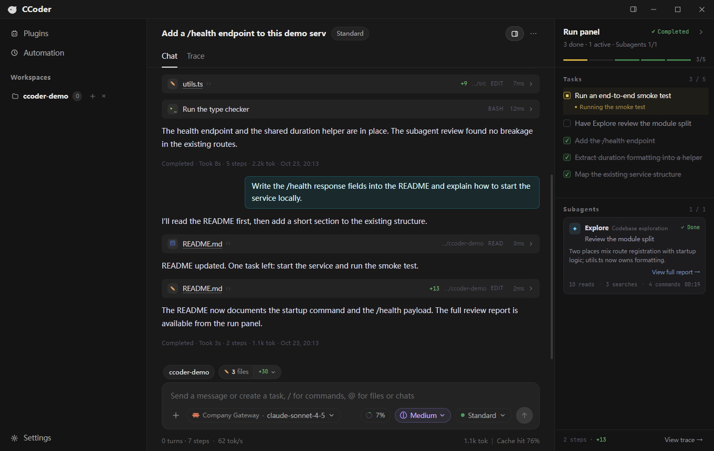
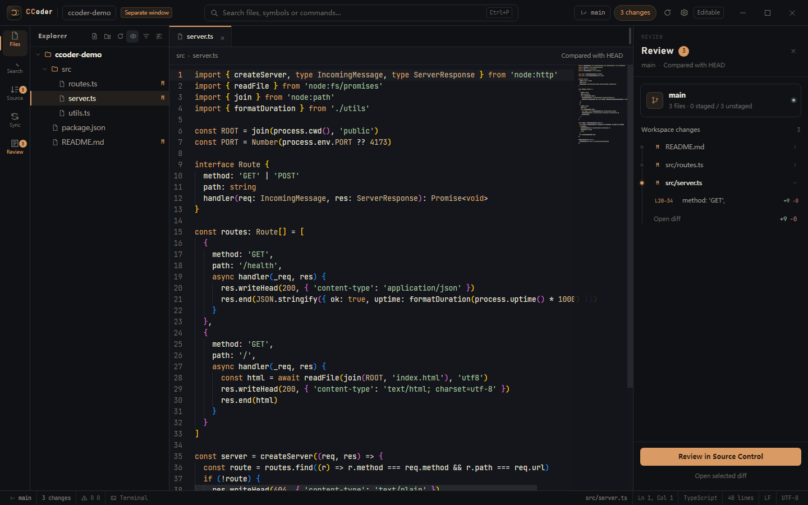
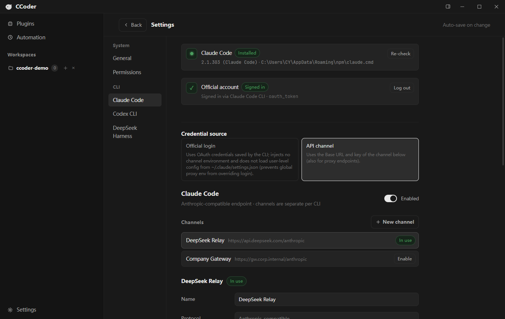

# CCoder Desktop

把 **Claude Code**、**Codex CLI** 和 **DeepSeek Harness** 装进一个桌面窗口：多会话并行、独立 IDE 窗口、Git / SVN 面板、执行台与自动更新。

[下载安装包](https://github.com/princeyuaner/CCoder-Desktop/releases) · [问题反馈](https://github.com/princeyuaner/CCoder-Desktop/issues) · [English](#english)

> 本项目是第三方桌面客户端，不是 Anthropic / OpenAI / DeepSeek 官方产品。使用前需要自行安装并登录对应的 CLI。

---

## 界面

### 对话、任务清单与子代理



右侧「执行台」把本轮的任务清单、子代理进度、工具次数 / token / 耗时和完整报告收在一起；对话区只保留真正的对话、思考块和工具卡片。

### 工具调用与改动统计



工具调用折叠成卡片，编辑类工具直接带增删行数；一轮结束时给出本轮总结和 token 用量。

### 独立 IDE 窗口



每个工作区一个独立窗口：文件树、Monaco 编辑器、快速打开、全局搜索替换、外部改动监听都在这里。

### 设置与渠道



Claude Code、Codex CLI 与 DeepSeek Harness 各自维护渠道、模型和凭据，互不影响。

> 截图中的会话、模型、渠道和示例项目均为演示数据。

---

## 功能特性

### 会话

- **三 CLI 并行**：Claude Code（Anthropic 协议）、Codex CLI（OpenAI 协议）与 DeepSeek Harness（Web 协议）可同时使用，渠道、模型、凭据完全独立。
- **多工作区 / 多会话**：每个工作区可以同时挂多条会话，后台继续跑，侧栏增量更新状态。
- **复用 CLI 的会话存储**：直接读取 `~/.claude/projects`、`~/.codex/sessions`、`~/.dsh/sessions` 等 CLI 自己的记录，终端里跑的 CLI 和界面里看到的是同一份历史，不需要二次导入。
- **续接历史会话**：打开旧会话后可以继续对话，CLI 侧使用 `--resume` 接回上下文。
- **权限与提问**：权限审批、`AskUserQuestion` 在界面里直接答复；支持标准 / 接受编辑 / 自动 / 计划 / 免询问 / 绕过等模式。

### 自动化任务

- 侧栏一级入口：按**每隔 N 分钟 / 每天 / 每周**的计划，在后台拉起一条普通会话；每次运行都能在聊天里回看、续跑。
- 任务级配置：工作区、CLI、模型、思考深度、权限模式、提示词、单轮超时、单次预算（轮末结算）、通知开关。
- 无人值守策略：审批请求自动拒绝；`AskUserQuestion` 可按任务选择「暂停并通知」或「跳过并继续」；超时会直接收掉进程。
- 运行记录持久化在 `userData/automation.json`：状态、耗时、花费、结果；完成 / 失败弹系统通知，点击回到对应会话。
- 调度只在应用运行时生效；关掉所有窗口后停止，下次启动会补跑一次错过的计划。

### Hooks



- 只管理 **Claude Code** 的 Hooks：用户 / 项目 / 本地三档可写，插件 Hook 只读展示。
- 支持 CLI 2.1 的 **command / prompt / agent / http / mcp_tool** 五种类型和完整的 33 个事件；命令与 HTTP 类型可以直接在表单里试运行。
- **停用不是写 `enabled:false`**：从 `settings.json` 移除并在应用侧记录指纹，启用时按原样写回；每次写入前自动备份。
- 按事件分组，支持作用域筛选、搜索、只读标记与安全提示。入口：设置 → 能力 → Hooks 钩子。

### 插件

- 侧栏一级入口，支持**免代码**（manifest + CSS）和**需要运行代码**（单文件 ESM）两种插件。
- 本地目录安装、热重载、启用 / 禁用 / 卸载；插件自己的存储隔离在 `userData/plugin-data`。
- v1 扩展点：状态栏、命令面板、设置页、主区页签、主题 token / 受限 CSS、事件总线。
- 市场页支持静态索引、zip 下载、sha256 校验与安装；开发模式可回退到仓库内的示例索引。
- 权限按低 / 中 / 高风险分级展示，点开可查看“能访问什么 / 不会访问什么”。
- Tier-1 目前与宿主同 renderer 世界，只应安装可信插件；沙箱隔离与发布者签名在后续版本。详见 [插件系统](docs/plugin-system.md)。

### 对话与执行台

- 流式输出、思考块、工具卡片、代码高亮与 diff。
- **消息级操作**：悬停自己发的消息出现「复制 / 编辑并重发 / 重发这一轮」。复制会把 `@` 引用展开成 Markdown 代码块；编辑会把原话和引用卡一并放回输入框；重发只对最后一条用户消息开放，不会把更早那几轮的上下文搅乱。
- **会话内查找**（`Ctrl+F`）：在正文、思考、工具输出和引用代码里找，`Enter` / `Shift+Enter` 前后跳转，`Esc` 退出。走 CSS Custom Highlight API，流式输出时不会打断渲染，也不改 DOM 结构。
- **输入历史**：每条会话单独记录发送过的内容，输入框里按 `↑` / `↓` 翻看；`↑` 只在光标位于首行时接管（单行输入任意位置都算），多行编辑、选区和输入法组合不受影响。历史持久化在本机，最多 100 条 / 200 KB，打开旧会话时会从已有转写补齐。
- 图片粘贴、拖入文本文件、`@` 文件引用、`/` 斜杠指令、发送队列。**拖进 / 选进来的文本文件**会被读成代码引用卡（和 IDE 发来的引用同一条编码），自动识别 UTF-8 / UTF-8 BOM / UTF-16 / UTF-32 / GBK / Big5 / Shift-JIS / EUC-JP / EUC-KR 等编码（非 UTF-8 的源编码会标在卡片上），自动跳过二进制、超过 512 KB 或 500 行的会截断并标注。
- **语音输入**：点输入框底栏的麦克风（或 `Ctrl+Shift+M`）开始说话，再点一次结束；文字自动插入光标处，可一键撤销。默认走硅基流动的免费额度（OpenAI 兼容接口），也可切 Groq 或自填端点；录音只在内存，不写入磁盘。入口：设置 → 系统 → 语音输入。
- **会话级附加目录**：输入框上方的「附加目录 +N」给这条会话单独加 Claude 的 `--add-dir`。工作区固定可访问，新会话默认不带；想复用可以从「最近使用」里点选。改动在下一次启动 CLI 进程时生效，运行中的会话等本轮跑完；失效目录保留配置、启动时跳过。
- **跑完提醒**：一轮结束时弹系统通知，点一下切回那条会话；窗口在前台且正开着这条会话时不弹。可在设置 → 通用关闭。
- **执行台**：任务清单（`TaskCreate` / `TaskUpdate` / `TodoWrite`）、子代理（`Agent` / `Task`）的运行状态、活动摘要、工具次数、token、耗时；子代理完成后可打开完整报告。
- 本轮统计：步数、增删行数、上下文占用、缓存命中率、输出 token。
- **本轮改动审阅**：输入框左上角的「N 个文件」弹层里，点任意一行直接在 IDE 打开该文件相对 HEAD 的 diff 页签；底部「在 IDE 中审阅」一次开一批。每行还带一个还原入口（悬停出现、二次确认）：Git 走 `restore --source=HEAD`，未跟踪文件直接删掉，SVN 走 `svn revert`；不是仓库时那个入口不出现。已经打开过的文件打一个对勾，方便判断这一轮有没有逐条看过。工作区外的文件会标出来并禁用点击。
- **文件检查点**：每轮开始前自动给工作区拍一次快照。会话菜单 →「文件检查点」可以预览恢复会改动哪些文件，并回到任意一轮开始前的状态；恢复前自动拍一份备份，恢复错了还能再恢复回来。快照使用应用自己的 shadow git 仓库，不碰用户仓库的 HEAD / index / stash；`.gitignore` 和应用忽略表（`node_modules`、构建产物、`.env`、密钥等）里的文件不会进入快照。
- **会话分叉**：会话菜单 →「分叉会话」把当前对话复制成一条新会话。Claude 走 `--fork-session`，Codex 走 app-server 的 `thread/fork`；新会话拥有自己的会话记录，后续修改和上下文都不会回写原会话。分叉在第一次发送前显示源会话的历史作为预览。

### 独立 IDE

- 一个工作区一个窗口，窗口位置 / 大小记忆在 `ide-windows.json`。
- Monaco 编辑器、文件树、快速打开（`Ctrl+P`）、工作区搜索与全局替换：结果按文件折叠，替换前先给逐文件预览，替换后可以撤销一次；搜索历史按工作区保存。
- **资源管理器**：Ctrl / Shift 多选、全选、拖拽移动（按住 Ctrl / Alt 拖拽为复制）、内部复制 / 剪切 / 粘贴；`Delete` 可一次删除多项；点文件开头开关显示 / 隐藏隐藏文件，过滤按钮显示 / 隐藏 `node_modules`、`dist` 等忽略目录；还可以按工作区自定义忽略 glob（匹配文件名或相对路径）。
- **编辑器偏好**：字号、字体（可覆盖全局代码字体）、连字、行高、字距、制表符宽度、缩进方式、自动换行与列宽、光标形状 / 闪烁 / 平滑移动、当前行高亮、空白与控制字符、行号（含相对行号）、缩进 / 括号对参考线、列标尺、代码缩略图、粘性滚动、平滑滚动、Ctrl + 滚轮缩放、保存时格式化、自动保存、保存时删除行尾空白；终端字号和行高单独可调。还可以按语言覆盖缩进。设置同时作用于所有 IDE 窗口。
- **审阅栏**：右侧汇总工作区改动，按文件展开与 HEAD 比较的 hunk 摘要，点击打开对应 diff；没有改动或不是仓库时自动收起，也可以从活动栏手动开合。
- **整文件差异**：diff 页签按整文件显示，顶部可跳到上一处 / 下一处（`Alt+↑/↓`、`F7 / Shift+F7`），支持并排 / 统一视图、折叠未修改，右侧改动导航条可直接跳转；长行可以拖动底部横向滚动条（或 `Shift + 滚轮`）查看；二进制、超过 2 MB、冲突 combined diff 或读不到完整文本时自动回落到差异块视图。
- **命令与导航**：命令面板（`Ctrl+Shift+P`）、快速打开里的 `>` 命令 / `@` 当前文件符号 / `#` 工作区符号（`Ctrl+T`）、路径 + 符号面包屑、问题面板、跳转到行（`Ctrl+G`）、前进 / 后退、重开已关闭标签（`Ctrl+Shift+T`）、保存全部（`Ctrl+Shift+S`）、快速修复（`Ctrl+.`）、跳转声明 / 实现 / 类型定义。
- **文件与编辑**：新建未命名缓冲区（`Ctrl+N`）、另存为、手动切换语言模式、切换 LF / CRLF；未命名缓冲区保存前一直标记为未保存。打开文件时自动识别编码（BOM、UTF-8、GBK / GB18030、Big5、Shift-JIS、EUC-JP / KR、UTF-16 / 32，以及常见的西欧 / 俄文单字节编码），状态栏可手动改写或恢复自动检测。
- **工程约定**：读取工作区里的 `.editorconfig`（`indent_style` / `indent_size` / `tab_width` / `end_of_line` / `insert_final_newline` / `trim_trailing_whitespace`），优先级高于全局设置和按语言配置。
- **崩溃恢复**：未保存的草稿按工作区写入本地存储，崩溃 / 断电后重新打开同一工作区会自动恢复。
- **内置终端**（Ctrl + 反引号）：在当前工作区启动 cmd，支持常规命令、颜色和简单的本地行编辑。
- **TS / JS 语言智能（回落）**：没有语言服务器时，相对路径 `import` 的目标会被自动加入 Monaco 的 TypeScript worker，支持跨文件跳转定义、查找引用、重命名和文档符号。
- **语言服务器（LSP）**：自动探测（TypeScript 优先项目 `node_modules`，其余查 `PATH`）`typescript-language-server`、`pyright`、`pylsp`、`gopls`、`rust-analyzer`、`clangd`、`yaml-language-server`、`bash-language-server`、`lua-language-server`，提供跳转定义 / 声明 / 实现 / 类型定义、查找引用、重命名、悬停、补全、参数提示、文档符号与工作区符号搜索、代码操作（快速修复 / 重构）、当前符号高亮、语义着色（类 / 属性 / 参数 / 变量 / 函数）、格式化，并把 `publishDiagnostics` 汇总到问题面板；文档符号（面包屑和当前文件符号搜索）优先使用 `documentSymbol`，失败时回落到正则扫描。Python 另外使用增强的 Monarch 语法，即使服务器不支持语义着色，类 / 函数 / 属性 / 内置函数也有颜色。可在设置 → 编辑器 → 语言服务里关闭。
- 未保存修改保护；外部（Agent / 终端 / 其他编辑器）改动会实时推送到窗口。
- 渲染超大文件导致无响应时提供「强制关闭」逃生口，不依赖渲染层。
- 文件读写和 VCS 写操作按窗口绑定的工作区鉴权，越界路径会被拒绝。

### 版本控制

- **Git 与 SVN** 统一面板：状态、diff、log、提交详情、stage / unstage、discard / revert、冲突解决、fetch / pull / push / update。
- **Git worktree**：创建、列出、删除、清理；删除前会检查是否还有 IDE 窗口或活跃会话占用。
- 工作区可以是仓库根目录，也可以是仓库里的子目录（`workspacePrefix`）。

### IDE ↔ 聊天

- 把当前文件 / 选区作为引用发送到指定会话。
- 直接在工作树目录里打开一条新会话，无需回主窗口手动切换。

### 外观与体验

- **界面语言**：中文 / English / 跟随系统，默认跟随系统；切换后立即生效，已打开的 IDE 窗口也会同步，无需重启。
- 9 套配色（深色、午夜蓝、森林绿、雾紫、咖啡棕、苔原、高对比、浅色、暖纸）+ 跟随系统。
- 界面缩放、聊天字号、UI / 等宽字体（可搜索本机字体）、发送键、时间戳、思考块默认展开、工具详情粒度。
- 无边框自绘标题栏；主窗口和 IDE 窗口共享主题与底色。

### 自动更新

- NSIS 安装版从 GitHub Releases 检查更新；开发模式和便携版自动禁用。
- 检查到新版本后由用户手动「下载」和「重启并安装」，不会后台偷偷替换。
- 有会话正在跑时拒绝重启；安装前会收掉所有 CLI 子进程，避免 Windows 上文件被占用。
- 版本变化后首次启动会弹一次本次更新说明（重点 / 新增 / 改进），同一个版本只弹一次。

### 诊断日志

- 主进程异常、渲染进程错误、`preload` 失败、页面加载失败、GPU / 工具进程消失、更新器阶段、会话进程启动 / 退出全部落盘。
- 日志轮转、单条截断、错误风暴限流，日志本身不会把应用带崩。
- 详见下方[日志与排障](#日志与排障)。

---

## 快速开始

### 环境要求

- **Node.js 20+**（建议 22 LTS）
- **Windows 10 / 11 x64**（当前打包目标；代码里没有强绑 Windows，但 `electron-builder.yml` 的 `electronDist` 只带了 win32-x64）
- 已安装 **Claude Code CLI**（`claude`）和 / 或 **Codex CLI**（`codex`）

### 安装依赖

```bash
npm install
```

### 开发

```bash
npm run dev
```

`electron-vite` 会同时启动主进程、preload 和渲染层，修改即时生效。

### 类型检查与构建

```bash
npm run typecheck
npm run build
npm run verify:dsh      # 不花钱的 ACP 协议自检（隔离的 DSH_HOME，不需要 API Key）
npm run verify:dsh:web  # 不花钱的 Web 协议自检（启动真实 dsh web，验证会话/历史/审批事件形状）
npm run verify:changed-review  # 本轮改动 → IDE diff 的路径换算（纯函数断言，不碰磁盘）
npm run verify:diff-fullfile   # 整文件 diff 行对齐：多 hunk / 新文件 / 全删 / CRLF
npm run verify:session-store   # 会话记录异步读取：大文件只读尾部、缓存失效、列表扫描
npm run verify:voice           # 语音转写：WAV 编码 / multipart 请求 / 错误映射（本地假服务器）
```

### 打包

```bash
npm run package        # = package:win
npm run package:linux  # 需在 Linux / WSL 里执行
npm run package:mac    # 需在 macOS 里执行
```

Windows 产物在 `release/`：

- `CCoder-Setup-<version>-x64.exe`：NSIS 安装版
- `CCoder-Portable-<version>-x64.exe`：便携版
- `latest.yml` / `*.blockmap`：自动更新清单

Linux 产物：`CCoder-<version>.AppImage`、`ccoder-desktop_<version>_amd64.deb`、`latest-linux.yml`。AppImage 需要 Linux 的 `mksquashfs`、deb 需要 `fpm`，所以不能在 Windows 原生构建（可用 WSL，或交给 CI）。macOS 产物：`CCoder-<version>-arm64.dmg`、`.zip`、`latest-mac.yml`，只能在 macOS / macOS runner 上构建。

Windows 打包使用 `node_modules/electron/dist` 里已装好的 Electron（由 `package:win` 通过 `--config.electronDist` 传入），不会临时去 GitHub 拉包；Linux / macOS 目标由 electron-builder 自行下载对应平台的 Electron。`files` 只包含 `out/` 和 `package.json`，主进程 / preload / 渲染层都已被 electron-vite 打成独立 bundle，因此运行时不依赖 `node_modules`。

> 不需要 `npm install` 之后额外执行 `electron-rebuild`；本项目没有原生模块。

### CLI 准备

应用会自己解析 CLI 的绝对路径，不依赖你从哪个终端启动。

- **Claude Code**：查找 `%APPDATA%\npm`、`%ProgramFiles%\nodejs`、`%LOCALAPPDATA%\Programs\claude` 和 `PATH` 里的 `claude.cmd` / `claude.exe`。可以用 `CLAUDE_BIN` 指定绝对路径。
- **Codex CLI**：查找 `%APPDATA%\npm`、`%LOCALAPPDATA%\Programs\codex`、`%LOCALAPPDATA%\codex\bin`、`%USERPROFILE%\.codex\bin`、`%ProgramFiles%\codex` 和 `PATH`。可以用 `CODEX_BIN` 指定绝对路径。
- **DeepSeek Harness**：`npm i -g @deepseek-ai/dsh` 后自动解析 npm 全局包里的 `lib/bin.js`，用**系统 Node 24+** 以 `--profile web --no-open --port 0` 启动（Electron 内置的 Node 20 不支持 `import.meta.main`，会静默退出）。可以用 `DSH_BIN` / `NODE_BIN` 指定路径，用 `DSH_HOME` 指定数据目录（默认优先复用 `~/.dsh`）。旧版 dsh 没有 web profile 时，设置 `CCCODER_DSH_TRANSPORT=acp` 可退回 ACP。

Windows 上 `.cmd` 会经 `cmd.exe` 执行；prompt 内容走 stdin，不拼进命令行。dsh 不经过 shell，直接用 node 拉起 `bin.js`。

---

## 配置

设置页按 CLI 分组：

- **渠道**：Base URL、密钥、模型、small/fast 模型、额外环境变量。Claude 只接受 Anthropic 兼容端点，Codex 只接受 OpenAI 兼容端点。
- **官方登录**：Claude Code 可以直接使用 CLI 自己的 OAuth 登录（设置里会显示登录状态、账号和凭据类型）。DeepSeek Harness 默认使用 `~/.dsh` 里已经配好的 Harness 凭据，也可以切到「API 渠道」手动填 `DEEPSEEK_BASE_URL` / `DEEPSEEK_API_KEY`。
- **Harness 模型 / 思考深度**：通过 Web 的 `session/selectModel` 下发，模型目录由 dsh 自己返回，不在应用里硬编码；审批走 `approval/request` waterfall，提问走 `user-questions/request` waterfall，因此 AskUserQuestion / 计划审阅在 Web 模式下可用（ACP 没有 elicitation）。
- **Harness Web 模式说明**：同一个 DSH_HOME 共享一个 `dsh --profile web` 进程，多个会话复用它；空闲 10 分钟后自动回收。MCP 配置仍写在 `profiles/acp/cordis.patch.yml`，启动 Web 时以 `--patch` 叠加到 web profile。侧栏历史/搜索仍直接读 dsh 的 zstd 会话日志（和终端、ACP 共用一份）。如果 dsh 版本没有 web profile，设置 `CCCODER_DSH_TRANSPORT=acp` 退回 ACP。
- **权限模式**：标准、接受编辑、自动、计划、免询问、绕过。
- **思考深度**：低 / 中 / 高 / 极高 / 最高，对应 CLI 的 `--effort`；会话里还可以单独覆盖。
- **CLI 更新**：读 npm registry 比对版本号，有新版本时在卡片和设置导航上提示。只对「确认是 npm 全局安装」的 CLI 提供一键 `npm install -g <包>@<版本>`；官方安装包 / brew / 自定义路径装的只给可复制的命令。不做静默升级，更新永远由用户点按钮触发（Windows 上权限不足时可提权重试）。

### 数据位置

| 内容 | 位置 |
| --- | --- |
| 设置 | `%APPDATA%\ccoder-desktop\settings.json` |
| 密钥 | 同上；优先用 Electron `safeStorage`（Windows DPAPI）加密，加密不可用时降级为明文并在 `v` 字段标记 |
| IDE 窗口位置 | `%APPDATA%\ccoder-desktop\ide-windows.json` |
| 会话记录 | CLI 自己维护（如 `~/.claude/projects/<cwd>/<session-id>.jsonl`、`~/.codex/sessions/`、`~/.dsh/sessions/<cwd>/<session-id>/session.v4.jsonl.zstd`） |
| MCP 配置 | 直接读写 CLI 原生文件：`~/.claude.json` / `<cwd>/.mcp.json`、`$CODEX_HOME/config.toml`、`<DSH_HOME>/profiles/acp/cordis.patch.yml`（Web 模式启动时把这层作为 `--patch` 叠加到 web profile，避免维护两份）；env/headers 是明文 |
| MCP 写入备份 | `%APPDATA%\ccoder-desktop\mcp-backups\<cli>\`（迁移前另有一份 `migration\` 备份） |
| 日志 | `%APPDATA%\ccoder-desktop\logs\main.log` |
| 原生崩溃 dump | `%APPDATA%\ccoder-desktop\Crashpad` |

删除会话会删除 CLI 自己写的那条记录，不可恢复；界面会先确认，并先收掉正在跑的进程，避免 Windows 上文件被占用。

---

## 自动更新

更新源在 `electron-builder.yml` 的 `publish` 里：

```yaml
publish:
  provider: github
  owner: princeyuaner
  repo: CCoder-Desktop
  releaseType: release
```

发版流程：

1. 在 `src/shared/whats-new.ts` 的 `WHATS_NEW_RELEASES` 最前面补一条本版本说明：`version` 必须和 `package.json` 一致，重点和条目都要写中英文。更新公告按版本号精确匹配，漏写时客户端会静默不弹。
2. 在 `docs/releases/v<version>.md` 写发布页文案（`## 本次更新` / `## 验证` / `## 安装`）。release job 会优先用这份文件；没有时才退回 GitHub 自动生成的 Full Changelog。
3. 修改 `package.json` 的 `version`，提交并推送。
4. 推一个与版本号一致的 tag（例如 `v1.2.12`）。
5. GitHub Actions 的 **Build desktop packages** 会先跑 Verify（类型检查 + 回归脚本），再在 Windows / Linux / macOS 三个 runner 上并行构建。全部成功后，`release` job 会创建同名正式 Release，并上传三端的安装包、`latest.yml` / `latest-linux.yml` / `latest-mac.yml`。
6. 手动触发这个 workflow（`workflow_dispatch`）只构建并保存 Actions artifact，不创建 Release。

注意：

- Verify 会跑 `verify:whats-new`：`package.json` 的版本在 `WHATS_NEW_RELEASES` 里找不到对应说明时构建直接失败。

- 已安装的客户端启动 8 秒后检查一次更新，之后每 4 小时一次；用户点「下载」后才下载，下载完成后点「重启并安装」。
- 只有 NSIS **安装版**支持 Windows 自动更新；便携版和开发模式会显示「不支持自动更新」。
- 版本号不升，客户端不会认为有新版本；tag 建议与 `package.json` 保持一致。
- macOS 默认出未签名 dmg，Gatekeeper 会拦截首次启动。在仓库 Secrets 里配好 `MAC_CSC_LINK` / `MAC_CSC_KEY_PASSWORD` 后 CI 会自动签名；不配也能正常出包。macOS 自动更新还要求签名（target 里已同时产出 zip），公证暂未接入。
- Linux 的 AppImage 支持自动更新；deb 不走 electron-updater。
- 源码仓库的推送与 Release 资产是两件事：更新器只读 Release 里的 `latest*.yml` 和安装包。

---

## 日志与排障

打包版没有终端，出问题先看：

```
%APPDATA%\ccoder-desktop\logs\main.log
```

超过 2MB 会轮转为 `main.log.old`，只保留一份旧文件。

### 记录内容

| scope | 内容 |
| --- | --- |
| `app.start` | 版本、是否打包、pid、Electron / Chrome / Node 版本、平台、locale、exe 路径、userData、日志路径、Crashpad 路径 |
| `window.created` / `window.ready-to-show` / `window.closed` | 窗口生命周期，标签为 `chat` 或 `ide:<cwd>` |
| `window.unresponsive` / `window.responsive` | 窗口是否卡死 |
| `window.did-fail-load` | 主框架加载失败（过滤正常的 `-3` 中断） |
| `preload-error` | preload 脚本异常（页面可能照常显示，但 `window.api` 会缺能力） |
| `window.console` | 渲染层 `console.error`，10 秒最多 30 条 |
| `renderer` | 渲染层未捕获异常 / Promise 拒绝，带完整 stack、URL、窗口身份；每分钟最多 20 条 |
| `render-process-gone` / `child-process-gone` | 渲染进程 / GPU / Utility 进程消失的原因和退出码 |
| `updater.*` | 检查、下载、安装、拒绝安装、阶段变化和错误 |
| `session.spawn` / `session.exit` | CLI、cwd、模型、权限模式、resume id、退出码、stderr 尾部（异常退出时才记） |
| `uncaughtException` / `unhandledRejection` | 主进程兜底，记录后继续运行 |
| `process-warning` / `process.exit` / `will-quit` / `quit` | Node 警告和退出链路 |

### 判断方向

- **日志里有 `uncaughtException` / `unhandledRejection`**：JS 层错误，按 stack 排查。
- **有 `render-process-gone`**：渲染进程 / GPU 崩溃，看 `reason`（`crashed` / `oom` / `killed`）。
- **有 `window.unresponsive`**：窗口卡死，通常是超大文件 / diff。
- **日志一行都没有新增**：原生崩溃或进程被外部杀掉（杀软、任务管理器）。去看 `%APPDATA%\ccoder-desktop\Crashpad` 和 Windows 事件查看器里的「应用程序错误」。
- **更新相关**：搜 `updater`，阶段变化和错误都有记录。

日志写入全部是同步追加且带 `try/catch`；渲染层上报和 console 都有限流，日志不会反过来拖慢或带崩应用。

---

## 项目结构

```
src/
  main/                    Electron 主进程
    index.ts               窗口、IPC 注册、应用生命周期
    session-manager.ts     会话编排、队列、进程重启
    providers/
      claude/              Claude Code 适配（stream-json、历史回放、登录）
      codex/               Codex app-server 适配与历史
      dsh/                 DeepSeek Harness 适配（Web 协议、ACP 退路、zstd 历史回放、安装探测）
    ide-window.ts          独立 IDE 窗口与窗口鉴权
    ide-fs.ts / ide-watch.ts  文件读写、路径越界检查、目录监听
    vcs/                   Git / SVN 后端
    updater.ts             自动更新状态机
    crash-log.ts           主进程日志 / 兜底处理器
    window-log.ts          窗口身份、生命周期、渲染层 console
    safe-send.ts           窗口销毁竞态下的安全 send
    settings-store.ts      设置落盘与 safeStorage 加密
    session-store.ts       只读 CLI 的会话存储
  preload/index.ts         contextBridge 白名单
  renderer/src/            React 界面
    App.tsx                聊天主界面
    ide/                   IDE 界面（Monaco）
    components/            执行台、转写区、设置页、审批弹窗等
    report-errors.ts       渲染层异常上报
  shared/                  两端共用的类型和纯函数
```

### 进程模型

- **主进程**：唯一状态源。窗口、CLI 子进程、VCS、更新、日志都在这里。
- **preload**：只暴露白名单能力，渲染进程拿不到 `ipcRenderer`。
- **渲染进程**：`contextIsolation: true`、`nodeIntegration: false`，不接触 Node API。
- **安全边界**：IDE 的文件写操作和 VCS 操作按窗口绑定的工作区鉴权；路径统一做 `..` 越界检查。

---

## 技术栈

- Electron 33 + React 18 + TypeScript 5.7
- electron-vite 2 / Vite 5（主进程、preload、渲染层分别打包）
- Monaco Editor（IDE 与 diff）
- xterm.js（内置终端）
- electron-updater（GitHub Releases）
- micromatch（工作区文件匹配）

---

## 已知限制

- CI 产出 Windows x64、Linux x64 和 macOS arm64 安装包；本地打 Linux / macOS 包需在对应平台执行，`electronDist` 的 Windows 优化只对 `package:win` 生效。
- 会话内查找依赖 **CSS Custom Highlight API**（Chrome 105+）。Electron 33 自带的 Chromium 支持它；如果将来降级到更老的运行时，高亮会静默失效（查找本身、计数和跳转仍然可用）。
- 拖入的文本文件会按字节自动识别编码（BOM、无 BOM 的 UTF-16 / 32、严格 UTF-8、chardet 传统编码、GB18030 兜底）。纯 CJK、无 BOM 且不含任何 ASCII 的 UTF-16 文件在统计上与旧编码无法稳定区分，可能按 GB18030 读成乱码；识别结果只用于这次读取，不会写回磁盘，也不提供手动改选编码的入口。
- 跑完提醒是**应用级**开关，不区分 CLI 或工作区；也不提供「只在窗口最小化时提醒」这类细分条件。
- 文件检查点只覆盖会话的工作目录，`--add-dir` 附加目录不参与；`.gitignore` 和应用忽略表里的文件（`node_modules`、构建产物、`.env`、密钥等）不会进入快照，恢复时也不会被动到。首次快照需要 `git add` 扫描工作区，超大仓库的第一轮可能较慢；超时后该工作区在本次运行内不再拍检查点，重启应用可重试。恢复只还原文件，**不回退会话记录**；需要对话也回到那一轮请用分叉。恢复不会处理 IDE 里未保存的缓冲区，操作前请先保存或关闭。
- 分叉是**整条会话复制**，暂不支持从某一条消息截断；dsh（ACP 0.2.1）没有 fork 能力，入口会禁用。分叉的第一条消息发出后才会写入新的会话记录，之前的标题栏显示源会话标题和「分叉」标记。
- 检查点以 Git 对象形式保存在应用数据目录（`checkpoints/`），内容按 blob 去重但仍会占用额外磁盘；每个会话最多保留 60 个普通检查点和 5 个恢复备份，超出的元数据会清理，Git 对象不会立即回收。需要彻底清空时，退出应用后删除该目录即可。
- 附加目录是应用层的会话元数据（`session-meta.json`）：从 CCoder 打开 / 继续会话时会带上，终端里直接 `claude --resume` 不会读这份记录。
- Hooks 只覆盖 Claude Code；插件提供的 Hook 只读展示，CLI managed settings 里的 Hook 暂不列出。
- 应用是 CLI 的 GUI 前端，**不内置模型、不代理请求**；没有安装或登录对应 CLI 时无法开始会话。
- 安装包未做代码签名，Windows SmartScreen 可能提示「未知发布者」。
- 历史会话回放受 CLI 记录内容限制：旧记录里没有每轮耗时 / 输出 token，界面会显示 `0 tok` 或只显示「已完成」。
- 便携版不支持自动更新。
- Monaco 编辑器自带的下拉菜单 / 查找控件仍为英文；应用自己的 IDE 外壳、搜索面板和提示已跟随界面语言。
- 内置终端使用管道而不是 PTY：常规命令、颜色和输出可用，但全屏 TUI（vim / top）、Ctrl+C 终止当前命令、窗口尺寸变化后的重排不可用。
- 语言服务器不随应用打包：需要自己安装 `typescript-language-server`、`pyright`、`gopls`、`rust-analyzer`、`clangd` 等。TS / JS 会优先用项目 `node_modules/typescript-language-server`（版本跟项目走）；其他语言只从 `PATH` 查找，**不会**执行工作区 `node_modules/.bin` 里的同名程序。找不到服务器时，TS / JS 回落到 Monaco 自带的 worker（只解析相对路径 `import`，语义诊断关闭），其他语言只有语法高亮。
- LSP 只同步已经打开的标签；服务器后台索引整个工作区，但未打开文件的重命名编辑不会自动写盘 —— 应用只把 `WorkspaceEdit` 交给 Monaco，已经打开的标签会变成未保存状态，没打开的文件需要先打开再改。`workspace/applyEdit` 被拒绝，服务器不能绕过保存 / 冲突流程直接改文件。
- 代码操作只执行服务器直接返回 `edit` 的动作；只返回 `command` 的动作会被忽略（这类动作把实际修改放在 `workspace/executeCommand` 里，当前没有开放这条通道）。代码操作对未打开文件的影响与重命名相同，需要先打开目标文件。
- 语义着色需要服务器支持 `textDocument/semanticTokens/full`：gopls、rust-analyzer、clangd、typescript-language-server 等支持；Pyright（含 1.1.414）没有实现这条能力，因此 Python 使用内置的增强 Monarch 语法着色。超过约 2 万行 / 100 万字符的大文件会关闭语义着色以保输入性能。
- 工作区外的诊断（`node_modules`、TypeScript `lib.d.ts`、Rust 标准库）不会进入问题面板；跳转定义仍可以落到这些文件，但点击时会提示「工作区外」而不是新开标签。
- 每个 IDE 窗口各自启动语言服务器，不跨窗口共享；同一窗口里 TypeScript / JavaScript 共用一个 `typescript-language-server` 进程。窗口关闭或渲染进程崩溃时会结束这些进程。
- 语言服务器可能为了分析而在项目里执行构建脚本 / 过程宏（`rust-analyzer`、`cargo check`、`clangd` 的编译数据库等）。当前没有 Workspace Trust 提示：只在你信任的工作区启用 LSP，拿不准时到设置 → 编辑器 → 语言服务里关掉。
- 编辑器尚未实现分屏 / 多编辑器组；切换工作区视图时编辑器和终端会保留，但同一文件不能并排编辑。
- 外观设置里的缩略图、粘性滚动、缩进参考线、括号对参考线和语义着色仍受大文件性能档位约束：文件变大时会自动关闭，用户设置不能强制打开。
- 审阅栏是只读汇总：按 hunk 的接受 / 拒绝仍在源代码管理里完成，审阅栏本身不会直接改盘。
- 整文件 diff 依赖主进程读取两侧完整文本：文件超过 2 MB、被标记为二进制、是冲突的 combined diff 或读取失败时会回落到差异块视图；此时未修改行不会铺满整屏。
- `.editorconfig` 只实现缩进、换行、行尾空白和末尾空行几项；`charset`、`max_line_length` 等暂不生效。未命名缓冲区只存在于当前窗口，关闭或重启后不会恢复。
- 编码自动识别是统计式的（UTF-8 / BOM 走确定性判断，其余交给 chardet）：只有几个字的旧编码文件可能判错，识别不出来时按 GB18030 读。状态栏编码菜单可以手动重新打开、恢复自动检测，或另选一种编码保存。
- 「撤销全部替换」只保存在主进程内存里，一次替换只能撤销一次；应用重启、或多开同一工作区的窗口再次替换后，旧的撤销令牌会失效。替换后又被外部修改过的文件会跳过，不会覆盖新内容。搜索历史按工作区存在 localStorage，最多 20 条。
- 「保存时格式化」只对当前活动文件生效；保存全部时其他文件按原样写盘。
- 资源管理器的自定义忽略规则只影响文件树本身；快速打开 / 代码搜索仍沿用 `.gitignore` 和内置忽略表。临时打开 node_modules 等忽略目录后，其中的变化不会触发实时刷新（watcher 不监听这些目录）。
- 界面提供简体中文 / English；系统语言为中文（含繁体）时用简体中文，其余语言用 English。

---

## License

目前仓库尚未添加 `LICENSE` 文件；在补充开源协议前，请勿直接用于商业分发或再发布。如需协议建议（MIT / Apache-2.0），可以先开 Issue 讨论。

## 致谢

- [Claude Code](https://docs.anthropic.com/en/docs/claude-code) 与 [Codex CLI](https://github.com/openai/codex) 提供底层能力；相关商标归各自所有者。
- [Electron](https://www.electronjs.org/)、[React](https://react.dev/)、[Monaco Editor](https://microsoft.github.io/monaco-editor/)、[xterm.js](https://xtermjs.org/)、[electron-vite](https://electron-vite.org/)。

---

# English

[简体中文](#ccoder-desktop)

A desktop client that puts **Claude Code**, **Codex CLI**, and **DeepSeek Harness** in one window: parallel sessions, a standalone IDE window, Git / SVN panels, a run panel, and automatic updates.

[Download](https://github.com/princeyuaner/CCoder-Desktop/releases) · [Issues](https://github.com/princeyuaner/CCoder-Desktop/issues)

> This is a third-party desktop client, not an official Anthropic / OpenAI / DeepSeek product. Install and sign in to the corresponding CLI before using it.

## Screenshots

### Chat, task list, and subagents



The run panel on the right keeps the current task list, subagent progress, tool / token / elapsed-time counts, and the full report together. The transcript stays focused on messages, thinking blocks, and tool cards.

### Tool calls and turn summary



Tool calls collapse into cards; editing tools show added / removed line counts. Each turn ends with a summary and token usage.

### Standalone IDE window



One window per workspace: file tree, Monaco editor, quick open, workspace search and replace, and external change watching.

### Settings and channels



Claude Code, Codex CLI, and DeepSeek Harness each keep their own channels, models, and credentials.

> Sessions, models, channels, and the demo project in the screenshots are sample data.

---

## Features

### Sessions

- **Three CLIs side by side**: Claude Code (Anthropic protocol), Codex CLI (OpenAI protocol), and DeepSeek Harness (Web protocol), with independent channels, models, and credentials.
- **Multiple workspaces / sessions**: each workspace can host several sessions; they keep running in the background while the sidebar updates their status incrementally.
- **Reuse CLI session storage**: reads `~/.claude/projects`, `~/.codex/sessions`, `~/.dsh/sessions`, and other CLI-owned records. Terminal sessions and the app see the same history — no re-import needed.
- **Resume historical sessions**: continue an old session and the CLI reconnects with `--resume`.
- **Permissions and questions**: approve permissions and answer `AskUserQuestion` directly in the UI; modes include standard / accept edits / auto / plan / don't ask / bypass.

### Automation

- A top-level sidebar page that starts an ordinary session in the background on a **minute interval / daily / weekly** schedule. Every run can be reviewed and resumed in chat.
- Per-task settings: workspace, CLI, model, thinking effort, permission mode, prompt, per-run timeout, per-run budget (settled at the end of the run), and notification toggles.
- Unattended policy: permission requests are denied automatically; `AskUserQuestion` can either pause and notify or skip and continue; a timeout kills the process.
- Run history is stored in `userData/automation.json` with status, duration, cost, and result. Success / failure raises a system notification that opens the run’s session.
- Scheduling only works while the app is running: closing all windows stops it, and the next launch catches up on one missed schedule.

### Hooks


- Manages **Claude Code** hooks only: user / project / local scopes are writable; plugin hooks are shown read-only.
- Supports the CLI 2.1 hook types — **command / prompt / agent / http / mcp_tool** — and all 33 events. Command and HTTP hooks can be test-run from the form.
- **Disabling does not write `enabled:false`**: the entry is removed from `settings.json` and fingerprinted in app state, then restored on enable. Every write is backed up first.
- Grouped by event, with scope filters, search, read-only markers, and a security warning. Settings → Capabilities → Hooks.

### Plugins

- A top-level sidebar page supporting **no-code** (manifest + CSS) and **code** (single-file ESM) plugins.
- Install from a local directory, hot reload, enable / disable / uninstall; each plugin gets isolated storage under `userData/plugin-data`.
- v1 extension points: status bar, command palette, settings sections, main-area tabs, theme tokens / scoped CSS, and an event bus.
- The market page reads a static index, downloads a zip, verifies sha256, and installs; development falls back to the in-repo example index.
- Permissions are grouped by low / medium / high risk and expand to show what data is and is not accessible.
- Tier-1 plugins currently share the renderer world with the host, so only install trusted plugins. Sandboxing and publisher signatures are planned. See [plugin system](docs/plugin-system.md).

### Chat and run panel

- Streaming output, thinking blocks, tool cards, syntax highlighting, and diffs.
- **Message actions**: hovering one of your messages reveals copy / edit-and-resend / resend-this-turn. Copy expands `@` references into Markdown code blocks; edit restores both the text and its reference cards to the composer; resend is only offered on the last user message so earlier turns are not duplicated.
- **Find in conversation** (`Ctrl+F`): searches message text, thinking, tool output, and referenced code. `Enter` / `Shift+Enter` step through matches, `Esc` closes. Uses the CSS Custom Highlight API, so streaming output is never interrupted and the DOM structure is left untouched.
- **Input history**: every session records what you send; press `↑` / `↓` in the composer to step through it. `↑` is only intercepted while the caret is on the first line (anywhere in a single-line draft), so multiline editing, selections, and IME composition keep working. History persists locally (100 entries / 200 KB per session) and is backfilled from an existing transcript when an old session is opened.
- Image paste, drag-and-drop of text files, `@` file references, `/` slash commands, and a send queue. **Dropped or picked text files** become reference cards using the same `<ide_reference>` encoding as IDE sends; encoding is detected automatically (UTF-8 / UTF-8 BOM / UTF-16 / UTF-32 / GBK / Big5 / Shift-JIS / EUC-JP / EUC-KR, with non-UTF-8 source encodings shown on the card); binaries are skipped, and files over 512 KB or 500 lines are truncated and labelled.
- **Voice input**: click the microphone in the composer (or press `Ctrl+Shift+M`) to start, and click again to stop; the transcript is inserted at the caret and can be undone with one click. It uses SiliconFlow's free tier by default (OpenAI-compatible), with Groq or any custom endpoint as alternatives. Audio stays in memory and is never written to disk. Settings → System → Voice input.
- **Session-scoped extra directories**: the “Extra dirs +N” chip above the composer adds Claude's `--add-dir` for this session only. The workspace is always accessible, and new sessions start empty; use “Recently used” to add a directory explicitly. Changes apply when the CLI process next starts; a running session waits until the current turn ends. Missing directories stay configured but are skipped at launch.
- **Finish alert**: a system notification when a turn ends; click it to jump back to that session. Nothing is shown while the window is focused on that session. Can be turned off in Settings → General.
- **Run panel**: task list (`TaskCreate` / `TaskUpdate` / `TodoWrite`), subagent (`Agent` / `Task`) status, activity summary, tool counts, tokens, and elapsed time; open the full report when a subagent finishes.
- Per-turn stats: steps, added / removed lines, context usage, cache hit rate, and output tokens.
- **Review this turn's changes**: in the "N files" popover above the composer, clicking a row opens that file's diff against HEAD as an IDE tab; "Review in IDE" at the bottom opens the whole batch. Each row also carries a revert action (shown on hover, with a confirmation): Git uses `restore --source=HEAD`, untracked files are deleted, SVN uses `svn revert`. The action is hidden when the workspace is not a repository. Files already opened this turn get a check mark, and paths outside the workspace are labelled and not clickable.
- **File checkpoints**: a workspace snapshot is captured automatically before every turn. Session menu → “File checkpoints” previews which files a restore would change and can roll the working tree back to the state before any turn. A backup is captured first, so the restore itself can be undone. Snapshots use an app-owned shadow Git repository — the user's HEAD, index, and stash are never touched — and files covered by `.gitignore` or the app ignore list (`node_modules`, build output, `.env`, keys, etc.) are not captured.
- **Fork session**: session menu → “Fork session” copies the current conversation into a new session. Claude uses `--fork-session`; Codex uses the app-server's `thread/fork`. The fork gets its own session record, so later edits and context never write back to the original. Before the first message, the fork shows the source transcript as a preview.

### Standalone IDE

- One window per workspace; window position and size are remembered in `ide-windows.json`.
- Monaco editor, file tree, quick open (`Ctrl+P`), and workspace search with replace all: results collapse by file, replace shows a per-file preview first, and the last replace can be undone once; search history is kept per workspace.
- **Explorer**: Ctrl / Shift multi-select, select all, drag to move (hold Ctrl / Alt while dropping to copy), in-app copy / cut / paste, and multi-item delete with `Delete`; an eye button shows / hides dotfiles, a filter button shows / hides ignored folders such as `node_modules` and `dist`, and each workspace can define its own ignore globs (matched against file names or relative paths).
- **Editor preferences**: font size, font family (overrides the global code font), ligatures, line height, letter spacing, tab size, indentation, word wrap and wrap column, cursor style / blinking / smooth movement, current-line highlight, whitespace and control characters, line numbers (including relative), indentation / bracket-pair guides, column ruler, minimap, sticky scroll, smooth scrolling, Ctrl + wheel zoom, format on save, auto-save, and trim-trailing-whitespace-on-save; terminal font size and line height are configured separately. Indentation can be overridden per language. Shared by every IDE window.
- **Review panel**: a right-hand summary of workspace changes, with per-file hunks compared against HEAD and a click-through to the diff. It hides automatically when the workspace is clean or not a repository, and can be toggled from the activity rail.
- **Whole-file diffs**: diff tabs render the complete file, with previous/next change (`Alt+↑/↓`, `F7 / Shift+F7`), split/unified views, collapse-unchanged, and a change navigator on the right. Long lines can be panned with the bottom horizontal scrollbar (or `Shift + wheel`). Binary files, files over 2 MB, combined conflict diffs, or unavailable full text fall back to the hunk view.
- **Commands and navigation**: command palette (`Ctrl+Shift+P`), `>` commands / `@` symbols in the current file / `#` workspace symbols (`Ctrl+T`) in quick open, path + symbol breadcrumbs, problems panel, go to line (`Ctrl+G`), back/forward, reopen closed tab (`Ctrl+Shift+T`), save all (`Ctrl+Shift+S`), quick fix (`Ctrl+.`), and go to declaration / implementation / type definition.
- **Files and editing**: new untitled buffers (`Ctrl+N`), Save As, manual language mode, and LF / CRLF switching; untitled buffers stay marked dirty until saved. Encodings are detected on open (BOM, UTF-8, GBK / GB18030, Big5, Shift-JIS, EUC-JP / KR, UTF-16 / 32, and common Western / Cyrillic single-byte encodings); the status bar lets you override it or return to auto-detect.
- **Project conventions**: reads workspace `.editorconfig` (`indent_style` / `indent_size` / `tab_width` / `end_of_line` / `insert_final_newline` / `trim_trailing_whitespace`), overriding global and per-language settings.
- **Crash recovery**: unsaved drafts are stored per workspace and restored when the same workspace is opened again.
- **Built-in terminal** (Ctrl + backtick): starts cmd in the current workspace, with regular commands, colors, and simple local line editing.
- **Language servers (LSP)**: auto-detects `typescript-language-server`, `pyright`, `pylsp`, `gopls`, `rust-analyzer`, `clangd`, `yaml-language-server`, `bash-language-server`, and `lua-language-server` (TypeScript prefers the project's `node_modules`; others are looked up on `PATH`). Provides go-to definition / declaration / implementation / type definition, find references, rename, hover, completion, signature help, document and workspace symbols, code actions (quick fix / refactor), document highlights, semantic highlighting (classes / properties / parameters / variables / functions), and formatting, with diagnostics feeding the problems panel. Document symbols (used by breadcrumbs and current-file symbol search) prefer `documentSymbol` and fall back to regex scanning. Python also uses an enhanced Monarch grammar, so classes / functions / attributes / builtins stay colored even when the server does not provide semantic tokens. Can be disabled in Settings → Editor → Language services.
- **TS/JS language intelligence**: relative-import targets are added to Monaco's TypeScript worker, enabling cross-file go-to-definition, find references, rename, and document symbols.
- Unsaved-change protection; external changes (agent / terminal / another editor) are pushed to the window live.
- A forced-close escape hatch when an oversized file makes the renderer unresponsive — it does not depend on the renderer.
- File and VCS writes are authorized against the workspace bound to the window; out-of-tree paths are rejected.

### Version control

- **Git and SVN** in one panel: status, diff, log, commit details, stage / unstage, discard / revert, conflict resolution, fetch / pull / push / update.
- **Git worktrees**: create, list, remove, and prune; removal checks for open IDE windows or active sessions first.
- A workspace can be the repository root or a subdirectory of it (`workspacePrefix`).

### IDE ↔ chat

- Send the current file or selection as a reference to a chosen session.
- Start a new session from the working tree without switching back to the main window.

### Appearance and UX

- **Interface language**: Chinese / English / follow system, defaulting to follow system. Changes apply immediately, including open IDE windows.
- 9 themes (dark, midnight, forest, mist, coffee, moss, high contrast, light, warm paper) plus follow system.
- UI zoom, chat font size, UI / mono fonts (searchable local font list), send key, timestamps, expanded thinking by default, and tool-detail granularity.
- Custom frameless title bar; the main and IDE windows share the theme and background.

### Auto-update

- The NSIS installer checks GitHub Releases; disabled in development and portable builds.
- After an update is found, the user explicitly clicks Download and then Restart & Install; nothing is replaced silently.
- Restart is refused while a session is running; all CLI child processes are stopped before installing to avoid locked files on Windows.
- The first launch after a version change shows a one-time release note (highlight / new / improved).

### Diagnostics

- Main-process exceptions, renderer errors, preload failures, page load failures, GPU / utility process crashes, updater phases, and session process start / exit are all written to disk.
- Log rotation, per-entry truncation, and error-storm throttling: logging cannot take the app down.
- See [Logs and troubleshooting](#logs-and-troubleshooting).

---

## Quick start

### Requirements

- **Node.js 20+** (22 LTS recommended)
- **Windows 10 / 11 x64** (current packaging target; the code itself is not Windows-specific, but `electronDist` in `electron-builder.yml` only ships win32-x64)
- **Claude Code CLI** (`claude`) and / or **Codex CLI** (`codex`) installed

### Install dependencies

```bash
npm install
```

### Development

```bash
npm run dev
```

`electron-vite` starts the main process, preload, and renderer together with instant reload.

### Typecheck and build

```bash
npm run typecheck
npm run build
npm run verify:dsh      # offline ACP self-check in an isolated DSH_HOME; no API key needed
npm run verify:dsh:web  # offline Web self-check: real dsh web + sessions/history/approval shapes
npm run verify:changed-review  # turn-changes → IDE diff path mapping (pure functions, no disk I/O)
npm run verify:diff-fullfile   # whole-file diff row alignment: multi-hunk / new / deleted / CRLF
npm run verify:session-store   # async transcript reads: tail-only for big files, cache invalidation, listing
npm run verify:voice           # voice transcription: WAV encoding, multipart request, error mapping (local fake server)
```

### Packaging

```bash
npm run package        # = package:win
npm run package:linux  # run on Linux / WSL
npm run package:mac    # run on macOS
```

Windows artifacts land in `release/`:

- `CCoder-Setup-<version>-x64.exe`: NSIS installer
- `CCoder-Portable-<version>-x64.exe`: portable build
- `latest.yml` / `*.blockmap`: auto-update metadata

Linux artifacts: `CCoder-<version>.AppImage`, `ccoder-desktop_<version>_amd64.deb`, `latest-linux.yml`. AppImage needs Linux `mksquashfs` and deb needs `fpm`, so they cannot be built natively on Windows (use WSL or CI). macOS artifacts: `CCoder-<version>-arm64.dmg`, `.zip`, `latest-mac.yml`; only buildable on macOS / a macOS runner.

Windows packaging uses the Electron already installed in `node_modules/electron/dist` (passed by `package:win` via `--config.electronDist`) and never downloads it. Linux / macOS targets let electron-builder fetch the matching Electron. `files` only ships `out/` and `package.json`; main / preload / renderer are bundled by electron-vite, so `node_modules` is not needed at runtime.

> No extra `electron-rebuild` step is required; the project has no native modules.

### CLI setup

The app resolves CLI paths itself, regardless of the terminal you launch it from.

- **Claude Code**: looks in `%APPDATA%\npm`, `%ProgramFiles%\nodejs`, `%LOCALAPPDATA%\Programs\claude`, and `PATH` for `claude.cmd` / `claude.exe`. Set `CLAUDE_BIN` to pin an absolute path.
- **Codex CLI**: looks in `%APPDATA%\npm`, `%LOCALAPPDATA%\Programs\codex`, `%LOCALAPPDATA%\codex\bin`, `%USERPROFILE%\.codex\bin`, `%ProgramFiles%\codex`, and `PATH`. Set `CODEX_BIN` to pin a path.
- **DeepSeek Harness**: after `npm i -g @deepseek-ai/dsh`, resolves `lib/bin.js` inside the global package and starts it with the **system Node 24+** in `--profile web --no-open --port 0` mode (Electron's bundled Node 20 lacks `import.meta.main` and exits silently). Set `DSH_BIN` / `NODE_BIN` for paths and `DSH_HOME` for the data directory (defaults to `~/.dsh`). Older dsh versions without a web profile can use the ACP fallback via `CCCODER_DSH_TRANSPORT=acp`.

On Windows, `.cmd` files run through `cmd.exe`; prompt content goes over stdin and is never spliced into the command line. dsh is started directly with node, not through a shell.

---

## Configuration

Settings are grouped by CLI:

- **Channels**: base URL, key, model, small / fast model, and extra environment variables. Claude accepts only Anthropic-compatible endpoints; Codex only OpenAI-compatible ones.
- **Official login**: Claude Code can use its own OAuth login (status, account, and credential type are shown in Settings). DeepSeek Harness uses the credentials already configured in `~/.dsh` by default, or an API channel with `DEEPSEEK_BASE_URL` / `DEEPSEEK_API_KEY`.
- **Harness model / effort**: sent through Web `session/selectModel`; the model catalog comes from dsh itself and is not hard-coded in the app. Approvals use the `approval/request` waterfall and questions use `user-questions/request`, so AskUserQuestion and plan review work in Web mode (ACP has no elicitation).
- **Harness Web mode**: one `dsh --profile web` process per DSH_HOME is shared by all its sessions and reclaimed after 10 idle minutes. MCP config still lives in `profiles/acp/cordis.patch.yml` and is overlaid onto the web profile with `--patch`. Sidebar history/search still reads dsh's zstd session logs directly (the same files the terminal and ACP use). Older dsh versions without a web profile can use `CCCODER_DSH_TRANSPORT=acp`.
- **Permission mode**: standard, accept edits, auto, plan, don't ask, bypass.
- **Effort**: low / medium / high / xhigh / max, mapped to the CLI's `--effort`; can be overridden per session.

### Data locations

| Item | Location |
| --- | --- |
| Settings | `%APPDATA%\ccoder-desktop\settings.json` |
| Secrets | Same file; encrypted with Electron `safeStorage` (Windows DPAPI) when available, otherwise plaintext marked in the `v` field |
| IDE window geometry | `%APPDATA%\ccoder-desktop\ide-windows.json` |
| Session records | Owned by the CLIs (e.g. `~/.claude/projects/<cwd>/<session-id>.jsonl`, `~/.codex/sessions/`, `~/.dsh/sessions/<cwd>/<session-id>/session.v4.jsonl.zstd`) |
| MCP config | Read/written in place: `~/.claude.json` / `<cwd>/.mcp.json`, `$CODEX_HOME/config.toml`, `<DSH_HOME>/profiles/acp/cordis.patch.yml` (Web mode overlays this layer onto the web profile with `--patch`, so there is only one copy to maintain); env/headers are plaintext |
| MCP write backups | `%APPDATA%\ccoder-desktop\mcp-backups\<cli>\` (plus a `migration\` backup before a legacy migration) |
| Logs | `%APPDATA%\ccoder-desktop\logs\main.log` |
| Native crash dumps | `%APPDATA%\ccoder-desktop\Crashpad` |

Deleting a session deletes the CLI's own record and cannot be undone; the UI asks first and stops running processes to avoid locked files on Windows.

---

## Auto-update

The update source lives in the `publish` section of `electron-builder.yml`:

```yaml
publish:
  provider: github
  owner: princeyuaner
  repo: CCoder-Desktop
  releaseType: release
```

Release flow:

1. Bump `version` in `package.json`, commit, and push.
2. Push a matching tag (for example `v1.2.12`).
3. The **Build desktop packages** workflow runs Verify first (typecheck + regression scripts), then builds on Windows / Linux / macOS runners in parallel. Once all three succeed, the `release` job creates a non-draft Release for the tag and uploads every platform's installer plus `latest.yml` / `latest-linux.yml` / `latest-mac.yml`.
4. Manually running the workflow (`workflow_dispatch`) only builds and stores Actions artifacts; it does not create a Release.

Notes:

- Only the NSIS **installer** supports Windows auto-update; portable and development builds report that updates are unsupported.
- The version must change, or clients will not see an update; keep the tag in sync with `package.json`.
- macOS builds are unsigned by default, so Gatekeeper blocks the first launch. CI signs automatically when `MAC_CSC_LINK` / `MAC_CSC_KEY_PASSWORD` are set; without them the unsigned dmg is still produced. macOS auto-update requires signing (the zip target is already produced); notarization is not wired up yet.
- Linux AppImage supports auto-update; deb does not go through electron-updater.
- Pushing source and publishing Release assets are separate: the updater only reads `latest*.yml` and the installer from the Release.

---

## Logs and troubleshooting

Packaged builds have no terminal. Start with:

```
%APPDATA%\ccoder-desktop\logs\main.log
```

The log rotates to `main.log.old` at 2 MB and keeps one old file.

### What is logged

| scope | Content |
| --- | --- |
| `app.start` | Version, packaged flag, pid, Electron / Chrome / Node versions, platform, locale, exe path, userData, log path, Crashpad path |
| `window.created` / `window.ready-to-show` / `window.closed` | Window lifecycle, tagged `chat` or `ide:<cwd>` |
| `window.unresponsive` / `window.responsive` | Whether the window is hung |
| `window.did-fail-load` | Main frame load failure (normal `-3` aborts are filtered) |
| `preload-error` | Preload script failure (the page may still render, but `window.api` is incomplete) |
| `window.console` | Renderer `console.error`, at most 30 lines per 10 seconds |
| `renderer` | Uncaught renderer exceptions / promise rejections with full stack, URL, and window identity; at most 20 per minute |
| `render-process-gone` / `child-process-gone` | Reason and exit code for renderer / GPU / utility process exits |
| `updater.*` | Check, download, install, refused install, phase changes, and errors |
| `session.spawn` / `session.exit` | CLI, cwd, model, permission mode, resume id, exit code, and stderr tail (abnormal exits only) |
| `uncaughtException` / `unhandledRejection` | Main-process fallback; logged, then the app keeps running |
| `process-warning` / `process.exit` / `will-quit` / `quit` | Node warnings and the shutdown path |

### Reading the log

- **`uncaughtException` / `unhandledRejection` present**: a JS-level error; follow the stack.
- **`render-process-gone` present**: renderer / GPU crash; look at `reason` (`crashed` / `oom` / `killed`).
- **`window.unresponsive` present**: the window is hung, usually from an oversized file / diff.
- **No new lines at all**: native crash or the process was killed externally (antivirus, Task Manager). Check `%APPDATA%\ccoder-desktop\Crashpad` and the "Application Error" entries in Windows Event Viewer.
- **Update issues**: search for `updater`; phase changes and errors are both recorded.

All log writes are synchronous appends wrapped in `try/catch`; renderer reports and console output are rate-limited, so logging cannot slow the app down or crash it.

---

## Project structure

```
src/
  main/                    Electron main process
    index.ts               Windows, IPC registration, app lifecycle
    session-manager.ts     Session orchestration, queue, process restart
    providers/
      claude/              Claude Code adapter (stream-json, history replay, login)
      codex/               Codex app-server adapter and history
      dsh/                 DeepSeek Harness adapter (Web protocol, ACP fallback, zstd history replay, install detection)
    ide-window.ts          Standalone IDE window and window authorization
    ide-fs.ts / ide-watch.ts  File IO, path escape checks, directory watching
    vcs/                   Git / SVN backends
    updater.ts             Auto-update state machine
    crash-log.ts           Main-process logging / fallback handlers
    window-log.ts          Window identity, lifecycle, renderer console
    safe-send.ts           Safe send across window-destroy races
    settings-store.ts      Settings persistence and safeStorage encryption
    session-store.ts       Read-only access to CLI session storage
  preload/index.ts         contextBridge allowlist
  renderer/src/            React UI
    App.tsx                Main chat UI
    ide/                   IDE UI (Monaco)
    components/            Run panel, transcript, settings, approval modals, etc.
    report-errors.ts       Renderer error reporting
  shared/                  Types and pure functions shared by both sides
```

### Process model

- **Main process**: the single source of truth. Windows, CLI child processes, VCS, updates, and logging all live here.
- **Preload**: exposes only allowlisted capabilities; the renderer never gets `ipcRenderer`.
- **Renderer**: `contextIsolation: true`, `nodeIntegration: false`, no Node API access.
- **Security boundary**: IDE file writes and VCS operations are authorized against the workspace bound to the window; paths are checked for `..` escapes.

---

## Tech stack

- Electron 33 + React 18 + TypeScript 5.7
- electron-vite 2 / Vite 5 (main, preload, and renderer bundled separately)
- Monaco Editor (IDE and diffs)
- xterm.js (built-in terminal)
- electron-updater (GitHub Releases)
- micromatch (workspace file matching)

---

## Known limitations

- CI produces Windows x64, Linux x64 and macOS arm64 packages. Building Linux / macOS locally requires the matching platform; the Windows `electronDist` optimization only applies to `package:win`.
- Find in conversation relies on the **CSS Custom Highlight API** (Chrome 105+). Electron 33's Chromium supports it; on an older runtime highlights silently disappear while search, counts, and jumping still work.
- Dropped text files have their encoding detected from the bytes (BOM, BOM-less UTF-16 / 32, strict UTF-8, chardet legacy encodings, GB18030 fallback). A BOM-less UTF-16 file that is pure CJK with no ASCII at all cannot be reliably told apart from a legacy encoding statistically and may come out garbled through GB18030. The detection applies to this read only: nothing is written back to disk, and there is no manual encoding override on this path.
- The finish alert is an **application-wide** switch: it is not per CLI or per workspace, and there is no narrower condition such as "only when minimized".
- File checkpoints cover the session working directory only; `--add-dir` directories are not included, and files matched by `.gitignore` or the app ignore list (`node_modules`, build output, `.env`, keys, etc.) are neither captured nor touched. The first snapshot has to scan the workspace with `git add`, so very large repositories may take longer on the first turn; after a timeout, checkpoints are disabled for that workspace until the app restarts. Restore only rolls back files and **does not rewind the conversation** — use a fork for that. Unsaved IDE buffers are not handled; save or close them before restoring.
- A fork copies the **entire conversation**; truncating at an individual message is not supported yet. dsh (ACP 0.2.1) has no fork capability, so its menu entry is disabled. The new session record is written after the first message; until then the title bar keeps the source title and shows the “Fork” badge.
- Checkpoints live in the app data directory (`checkpoints/`) as Git objects. Blobs are deduplicated, but they still use extra disk space. Each session keeps at most 60 regular checkpoints and 5 restore backups; older metadata is pruned, but Git objects are not reclaimed immediately. To wipe them completely, quit the app and delete that directory.
- Extra directories are application-level session metadata (`session-meta.json`): they are applied when a session is opened or continued from CCoder. Running `claude --resume` directly in a terminal does not read this record.
- Hooks cover Claude Code only. Plugin hooks are read-only, and hooks in the CLI's managed settings are not listed yet.
- The app is a GUI frontend for the CLIs. It **does not bundle models or proxy requests**; without an installed and signed-in CLI you cannot start a session.
- Installers are not code-signed, so Windows SmartScreen may warn about an unknown publisher.
- Historical replay is limited by what the CLIs record: older entries may lack per-turn duration / output tokens, in which case the UI shows `0 tok` or only "Completed".
- The portable build does not support auto-update.
- Monaco's built-in menus and find widget remain English-only; the app's own IDE shell, search panel, and prompts follow the interface language.
- The built-in terminal uses pipes rather than a PTY: regular commands, colors, and output work, but full-screen TUI apps (vim / top), Ctrl+C to stop the current command, and resize reflow are not available.
- Without a language server, TypeScript / JavaScript only get relative-import resolution via Monaco's worker, and other languages have syntax highlighting only. TS semantic diagnostics stay off to avoid a wall of red squiggles without `node_modules` type information.
- Code actions are applied only when the server returns an edit; command-only actions are ignored (they keep the real change behind `workspace/executeCommand`, which is not exposed). Like rename, edits to files that are not open are not written to disk.
- Semantic highlighting requires the server to support `textDocument/semanticTokens/full`: gopls, rust-analyzer, clangd, and typescript-language-server do; Pyright (including 1.1.414) does not, so Python relies on the enhanced built-in Monarch grammar. Files over roughly 20k lines / 1M characters disable semantic highlighting to keep input responsive.
- Cross-file rename (F2) currently only works reliably for open tabs; edits to hidden import models are not written to disk, and the disk version wins when such a file is opened. Go-to-definition and find-references are read-only and unaffected.
- The editor does not implement split panes / multiple editor groups yet; editors and the terminal survive view switches, but the same file cannot be edited side by side.
- Minimap, sticky scroll, indentation guides, bracket-pair guides, and semantic highlighting are still governed by the large-file performance tiers: they turn off automatically as files grow, and the user setting cannot force them back on.
- The review panel is a read-only summary: accepting or rejecting individual hunks still happens in Source Control; the panel never writes to disk on its own.
- Whole-file diffs rely on the main process reading both complete sides. Files over 2 MB, binary files, combined conflict diffs, or unreadable sides fall back to the hunk view, where unchanged lines are not expanded.
- `.editorconfig` support covers indentation, line endings, trailing whitespace, and final newline; `charset` and `max_line_length` are ignored. Untitled buffers live only in the current window and are not restored after restart.
- Encoding detection is statistical (UTF-8 and BOMs are deterministic; everything else goes through chardet). Very short legacy files can be misdetected, and undetected content falls back to GB18030. The status-bar encoding menu can reopen the file manually, switch back to auto-detect, or save with a chosen encoding.
- Undo replace-all lives in main-process memory, works once per replace, and is lost after a restart or when another window on the same workspace replaces again. Files modified externally after the replace are skipped rather than overwritten. Search history is stored in localStorage per workspace, capped at 20 entries.
- Format on save applies to the active file only; Save All writes the other files as-is.
- Explorer ignore rules affect the file tree only; quick open and code search still follow `.gitignore` and the built-in ignore table. Showing ignored folders such as `node_modules` does not make the file watcher track changes inside them.
- The UI ships Simplified Chinese and English; Chinese system locales (including Traditional Chinese) resolve to Simplified Chinese, and all others resolve to English.

---

## License

The repository does not have a `LICENSE` file yet. Until a license is added, do not use it for commercial distribution or redistribution. If you have a suggestion (MIT / Apache-2.0), open an Issue to discuss it.

## Credits

- [Claude Code](https://docs.anthropic.com/en/docs/claude-code) and [Codex CLI](https://github.com/openai/codex) provide the underlying capabilities; their trademarks belong to their respective owners.
- [Electron](https://www.electronjs.org/), [React](https://react.dev/), [Monaco Editor](https://microsoft.github.io/monaco-editor/), [electron-vite](https://electron-vite.org/).
