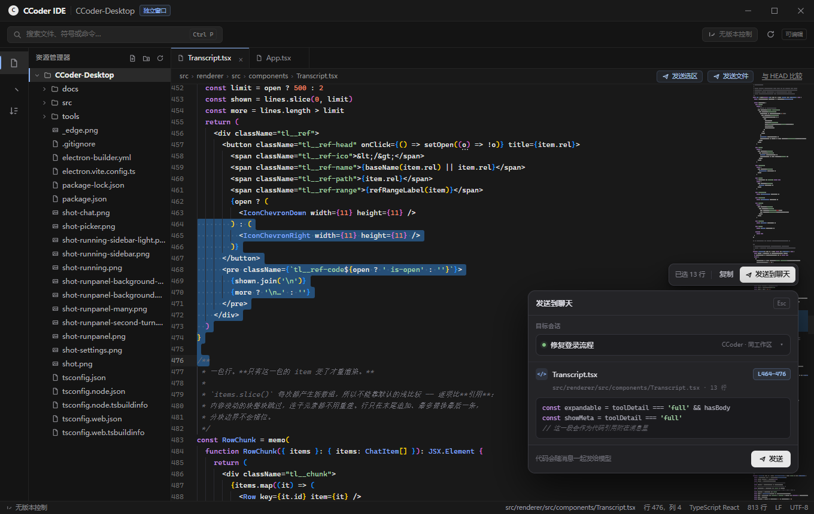
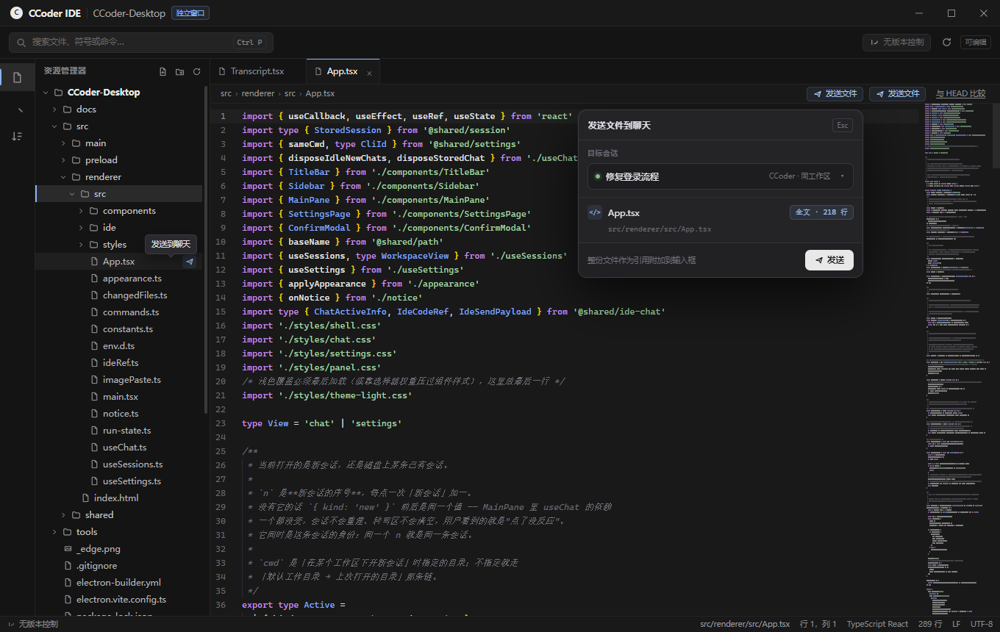
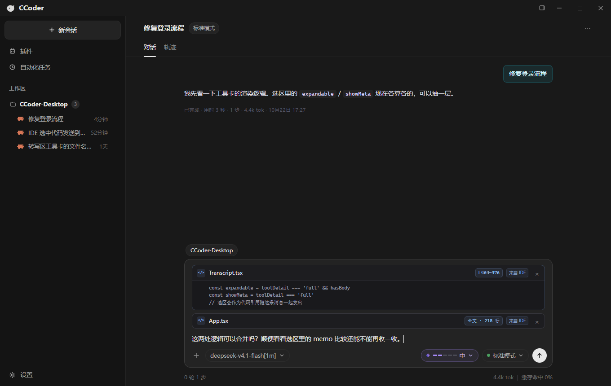

# IDE → 聊天：代码 / 文件发送（效果稿）

目标：在独立 IDE 窗口里看代码时，把**选中的一段代码**或**整个文件**送到同工作区的聊天输入框，作为消息的代码引用，补充说明后一起发给模型。

> 本目录是设计稿，界面元素由 `tools/shot-ide-send.cjs` 注入真实界面截图生成，尚未实现。

## 1. 选中代码发送

- 选中一段代码后，在编辑器里右键，菜单中出现「发送选区到聊天」。
- 点击后弹出确认层，展示：
  - **目标会话**：默认是同工作区当前聊天（`修复登录流程`），右侧可切换同工作区的其他会话。
  - **引用信息**：文件名、`L464–476`、相对路径、行数。
  - **代码预览**：确认选中的确实是这一段。
- 点「发送」不会直接发消息，而是把引用放进聊天输入框，用户补完说明再发送。

## 2. 整个文件发送

两个入口：

- **资源管理器**：右键文件，选择「发送到聊天」。
- **编辑器**：在编辑器里右键，选择「发送当前文件到聊天」。

确认层与选区一致，只是引用范围变成 `全文 · 218 行`，不再带行号区间。

## 3. 聊天框接收

- 代码引用显示在输入框上方，和图片附件处于同一区域。
- 每条引用都可以单独移除（`×`），也可以同时附多个：选区一段 + 整个文件。
- 标签 `来自 IDE` 标明来源；用户可以在输入框里继续写问题。
- 发送后，引用内容会随消息进入转录区，模型拿到的是完整代码文本，而不是只有一行路径。

## 交互约定

| 场景 | 行为 |
|---|---|
| 有选区，右键 →「发送选区到聊天」 | 发送选区（行号区间） |
| 编辑器右键 →「发送当前文件到聊天」 | 发送当前文件全文 |
| 资源管理器右键文件 →「发送到聊天」 | 发送该文件全文 |
| 目标会话 | 默认同工作区当前会话；下拉可切换同工作区其他会话 |
| 重复发送同一段 | 输入框里合并/去重，不叠加两份完全相同的引用 |
| 文件已删除 / 不在工作区 | 发送按钮置灰，并说明原因 |

## 已确定的实现口径

1. **目标会话**：默认同工作区当前活跃会话；下拉可切到同工作区其他已有会话。
2. **超长选区**：超过 500 行时弹提示，两个出口：「前 500 行」或「整份文件」。
3. **整文件内容**：默认发送全文（IDE 读取上限 2MB，超出时只发送读到的部分）。
4. **完成反馈**：IDE 右下角轻提示「已附加到聊天 · 会话名」，2 秒后自动消失；不抢聊天窗口焦点。

实现对应文件：

- IDE 侧：`src/renderer/src/ide/IdeApp.tsx`、`ide/SendToChat.tsx`、`ide/ref.ts`
- 主进程中转：`src/main/chat-bridge.ts`、`src/shared/ide-chat.ts`
- 聊天侧：`src/renderer/src/components/Composer.tsx`、`components/Transcript.tsx`、`ideRef.ts`
- 消息编码：引用块使用 `<ide_reference path="…" lines="…" lang="…">` + 动态围栏代码块；
  转写区和历史回放都会把它还原成引用卡，不会把 XML 直接显示给用户。
- 验证脚本：`tools/verify-ide-chat.cjs`

## 实际运行截图

- [选中代码后的浮动条](impl-ide-selection.png)
- [发送确认层](impl-ide-send-popover.png)
- [超过 500 行的提示](impl-ide-oversized.png)
- [聊天输入框里的引用卡](impl-chat-composer-ref.png)
- [发送后的转写区](impl-chat-sent.png)
- [浅色主题 · 确认层](impl-ide-selection-light.png)
- [浅色主题 · 转写区](impl-chat-sent-light.png)
