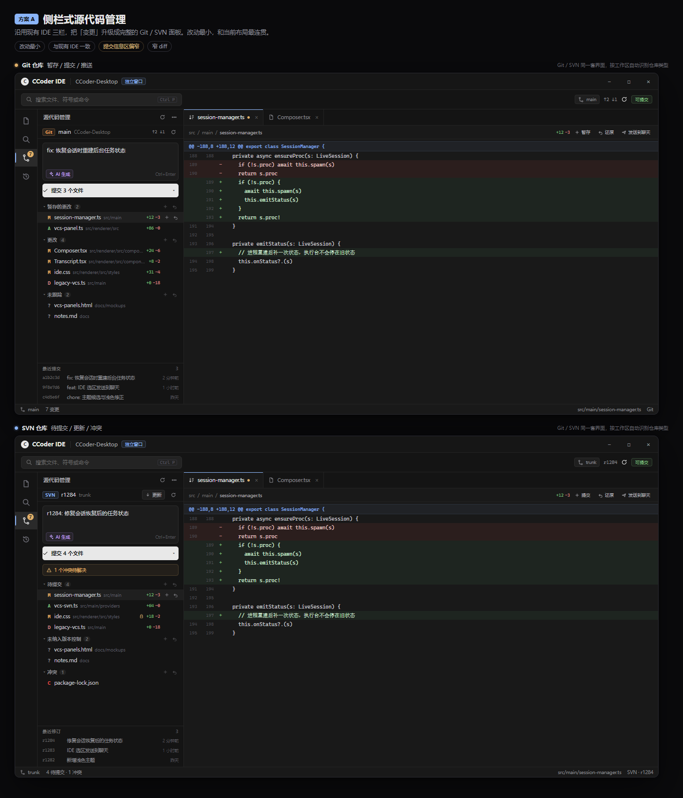
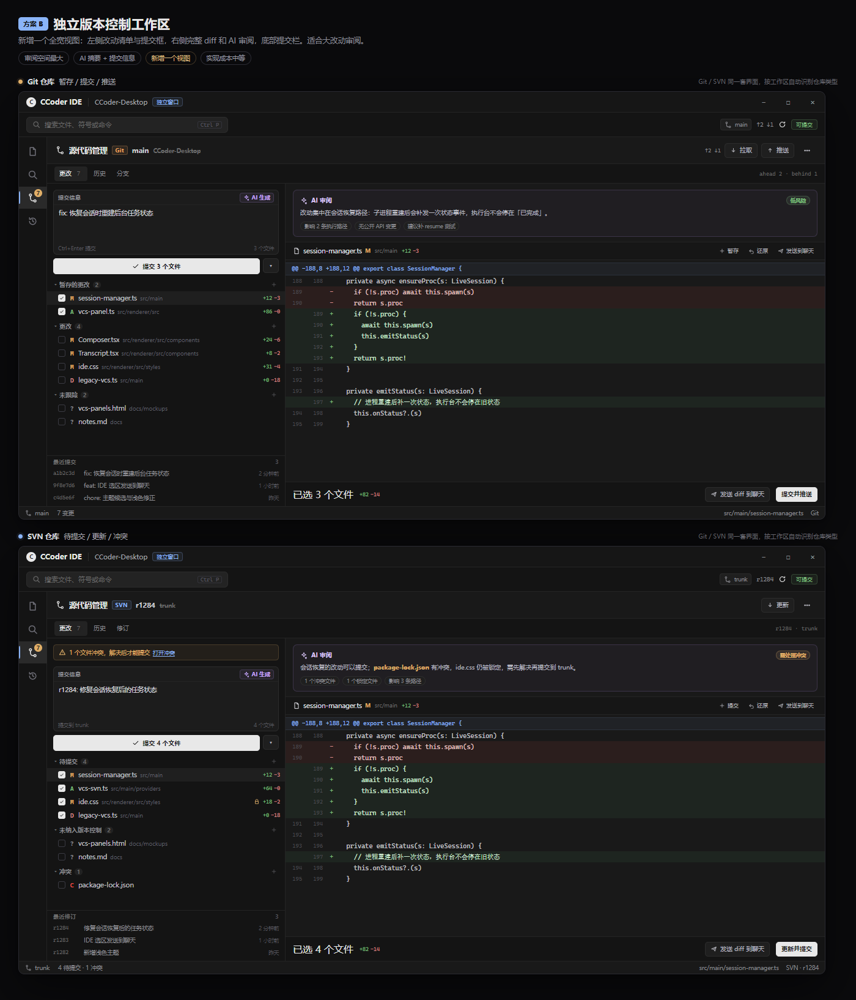
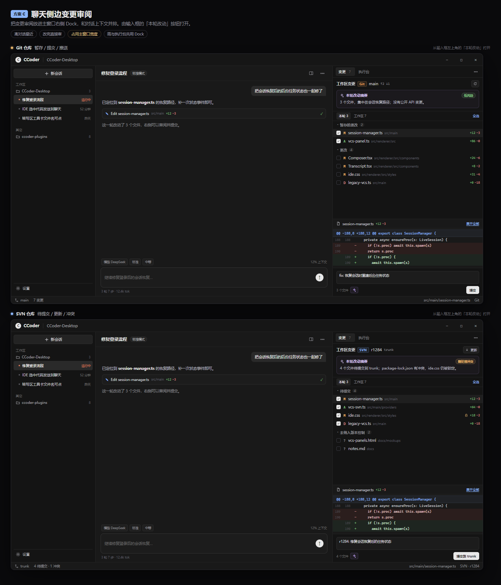

# Git / SVN 面板 · 三套方案

三套效果图都按同一套设计语言绘制，并且都展示了 **Git 仓库** 和 **SVN 仓库** 两种状态。

核心设计口径：**一套界面，两个适配器**。Git/SVN 的日常操作高度重合（状态、diff、提交、更新、冲突），
按工作区自动识别仓库类型，只对 SVN 特有的 revision / lock / changelist 做条件展示，避免维护两套会漂移的 UI。

## 方案 A · 侧栏式源代码管理

沿用现有 IDE 三栏，把当前的「变更」列表升级成完整面板。提交框、文件分组、最近提交都塞进 300px 侧栏。

- 适合：想以最小改动补齐功能，保持和现有 IDE 一致的操作路径。
- 代价：提交信息区偏窄；SVN 的锁定/冲突/修订信息会让侧栏更挤；diff 仍然只能看单栏。

## 方案 B · 独立版本控制工作区

在活动栏新增一个版本控制入口，打开全宽视图：左侧改动清单 + 提交框，右侧完整 diff + AI 审阅，底部提交栏。

- 适合：主要在这个窗口里完成「改 → 看 diff → 提交」的完整闭环，尤其是大改动。
- 代价：新增一个视图；提交、同步、冲突处理需要更完整的状态机。
- 亮点：AI 审阅卡和「生成提交信息」有足够空间；Git 的 stage/unstage 与 SVN 的 update/commit 可以各自表达。

## 方案 C · 聊天侧边变更审阅

把变更审阅放进主窗口右侧 Dock，和对话上下文并排，由输入框左上角的「本轮改动」按钮打开。

- 适合：以聊天为主、频繁让 Agent 改代码，然后立刻审阅的用法。
- 代价：占用主窗口宽度；需要和执行台共用一个 Dock；不适合长时间做完整的版本控制操作。

## 对比

| | A 侧栏 | B 独立工作区 | C 聊天侧边 |
|---|---|---|---|
| 改动成本 | 最小 | 中 | 中 |
| diff 空间 | 小 | 大 | 中 |
| 提交信息 | 窄 | 宽 | 中 |
| Git stage/unstage | 可以 | 最顺 | 可以 |
| SVN 锁定/冲突/修订 | 挤 | 最清楚 | 够用 |
| 与聊天上下文 | 分离 | 分离 | 最近 |
| 适合场景 | 快速补功能 | 主版本控制面板 | Agent 改完就审 |

## 建议

**推荐 B 作为主视图**，A 作为后续的「紧凑模式」可选入口，C 作为第二阶段增强。
如果只能先做一个，选 B：它能同时容纳 Git 和 SVN 的差异，也不会让提交框和 diff 互相抢空间。

实现上建议拆成：

- `src/main/vcs/`：`git.ts` / `svn.ts` / `types.ts`，统一输出 `status / diff / log / commit / update / revert`。
- `src/shared/vcs.ts`：跨进程数据形状，UI 不认任何 CLI 的私有输出。
- `src/renderer/src/ide/VcsPanel.tsx`：一套组件，按 `kind` 展示差异字段。
- IPC：`vcs:status`、`vcs:diff`、`vcs:stage`、`vcs:commit`、`vcs:update`、`vcs:log`、`vcs:revert`。
- 写操作全部走主进程，路径做工作区越界检查；提交信息通过 stdin 传给 `git commit -F -` / `svn commit -F`，避免 shell 注入。
- SVN 的密码/证书提示需要单独处理，不能假设命令一定非交互成功。

> AI 审阅和自动生成提交信息可以先留接口、后接模型；第一版先把状态、diff、提交、更新、还原做扎实。

## 实现状态（已落地）

按方案 B 实现，入口在 IDE 活动栏的「源代码管理」图标；统一的 Git / SVN 面板会按工作区自动识别仓库类型。

实际截图：

- [Git · 工作区改动](impl-vcs-workspace.png)
- [Git · 已暂存](impl-vcs-staged.png)
- [Git · 历史](impl-vcs-history.png)
- [Git · 冲突状态](impl-vcs-workspace-conflict.png)
- [SVN · 待提交 / 锁定](impl-vcs-svn-workspace.png)
- [SVN · 锁定文件 diff](impl-vcs-svn-locked.png)
- [SVN · 历史](impl-vcs-svn-history.png)
- [浅色主题 · Git 工作区](impl-vcs-workspace-light.png)

实现范围：

- Git：状态分组（暂存 / 更改 / 未跟踪 / 冲突）、working/staged/HEAD/revision diff、暂存 / 取消暂存 / 还原、提交 / amend、历史、fetch / pull --ff-only / push（含首次发布设置上游）。
- SVN：待提交 / 未纳入版本控制 / 冲突、锁定和 changelist 字段、working/revision diff、添加 / 还原 / 解决冲突、提交、更新、历史。
- 统一面板：工作区是仓库子目录时只显示子目录内的改动；Git 提交会提示可能包含整个暂存区，SVN 提交只包含勾选文件。
- 写操作全部在主进程执行，渲染层只传工作区相对路径；IDE 窗口按 cwd 绑定授权，聊天窗口调用会被拒绝。
- 提交信息通过 stdin 传给 `git commit -F -` / `svn commit -F -`，不走命令行拼接。

验证：

- `node tools/verify-vcs.cjs`（Git / SVN 适配器、冲突、锁定、子目录、空仓库）
- `node node_modules/electron/cli.js tools/verify-vcs-ipc.cjs`（真实 IPC、窗口授权、Git/SVN UI 暂存与提交）
- `node node_modules/electron/cli.js tools/shot-vcs-impl.cjs`（Git / SVN 效果图，支持 `VCS_KIND=svn`、`VCS_THEME=light`）
